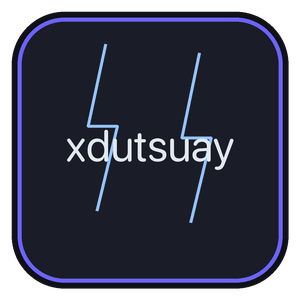
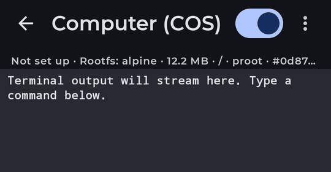
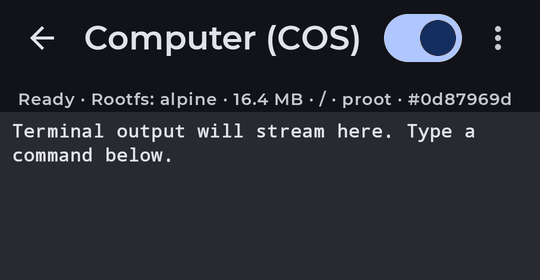
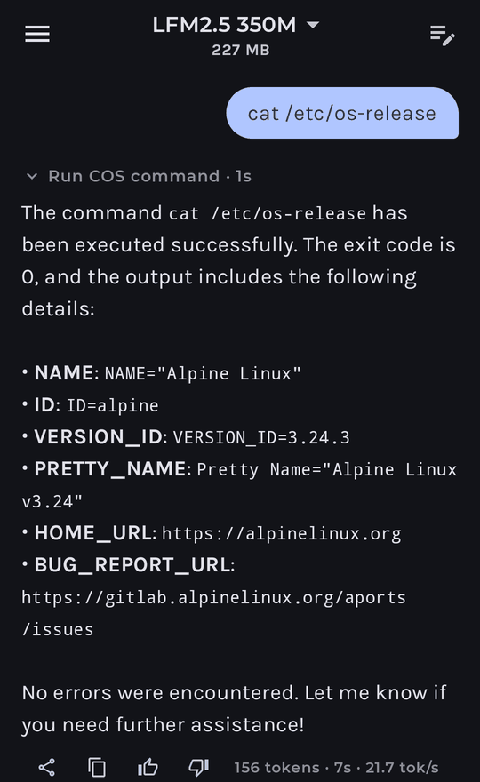
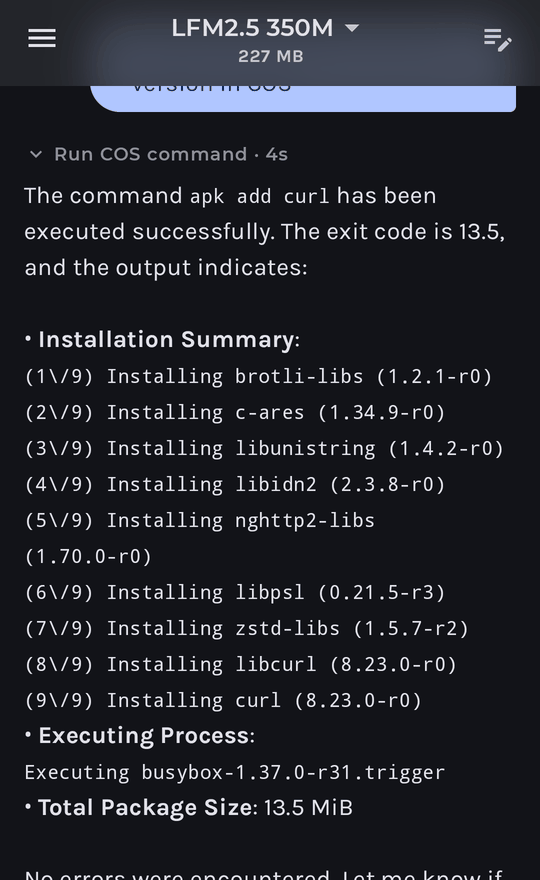
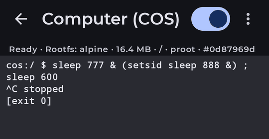
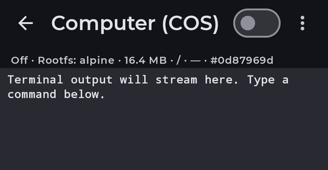
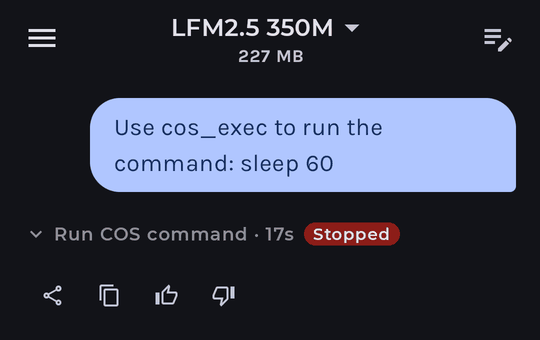

# chidori-nagasa

<p align="center">

</p>

<p align="center">
<strong>On-device LLM chat + LAN companion for the <a href="https://kaustubhtripathi.com/public/lab/lclreason/">chidori</a> desktop IDE.</strong>
</p>

<p align="center">
<a href="https://github.com/xdutsuay/chidori-nagasa/releases">Download APK</a>
·
<a href="https://kaustubhtripathi.com/public/lab/lclreason/#download">Desktop downloads</a>
·
<a href="WIRE_CONTRACT.md">Wire contract</a>
·
<a href="NOTICE.md">Attribution</a>
</p>

---

**chidori-nagasa** is the Android companion to [chidori](https://kaustubhtripathi.com/public/lab/lclreason/) — an AI-powered desktop IDE. On your phone it runs GGUF models locally (offline, private). When paired with a chidori desktop on the same LAN, it can monitor Ask / Agent / Plan / Debug runs, chat through the desktop's models, and optionally offer the phone as an inference node.

**Short name: CINDI.** In discussions, tickets and handovers, chidori-nagasa is called **CINDI**. "Chidori" alone means the desktop IDE. The opt-in Linux desktop inside the app is the **CINDI desktop**.

Built as a substantial fork of [LM Playground](https://github.com/andriydruk/LMPlayground) by Andriy Druk (MIT). Inference is powered by [llama.cpp](https://github.com/ggml-org/llama.cpp). See [`NOTICE.md`](NOTICE.md) and [`UPSTREAM_DIVERGENCE.md`](UPSTREAM_DIVERGENCE.md) for attribution and what changed.

> **Desktop source** (`lclreason`) stays private. Public desktop binaries ship from [xdutsuay/chidori](https://github.com/xdutsuay/chidori/releases). This Android repo is the open companion client.

## Why this fork exists

LM Playground already nails on-device chat. chidori-nagasa keeps that working and adds the pieces that make a phone useful next to a desktop AI IDE:

| Area | What we added |
|------|----------------|
| **LAN pairing** | mDNS (`_chidori._tcp`) + manual `host:8027`, pairing codes, bearer auth |
| **Coordinator monitor** | Live status and Ask / Agent / Plan / Debug run activity |
| **Remote chat** | Chat through the desktop's local/remote LLMs from the phone |
| **Phone as node** | Opt-in foreground service hosting an OpenAI-compatible facade so the desktop can route work to the phone |
| **Windows native builds** | Gradle probes for `glslc.exe`, Vulkan SDK / SPIRV headers, `-PggmlVulkan=off` escape hatch |
| **CINDI (COS desktop)** | Opt-in graphical Alpine desktop (Xvfb fbdir + xdotool); chat tools `cos_screenshot` / `cos_gui`; live viewer on the Computer screen |

The wire protocol, product scope, and roadmap live in [`CHIDORI_PROTOCOL.md`](CHIDORI_PROTOCOL.md), [`WIRE_CONTRACT.md`](WIRE_CONTRACT.md), [`PRD.md`](PRD.md), and [`ROADMAP.md`](ROADMAP.md). Desktop implementers: start at [`DESKTOP_HANDOFF.md`](DESKTOP_HANDOFF.md). The app's network and telemetry notes are in [`docs/SECURITY-TELEMETRY.md`](docs/SECURITY-TELEMETRY.md).

## Download

Download a sideloadable APK from [Releases](https://github.com/xdutsuay/chidori-nagasa/releases) (no Play Store account). This checkout builds version **3.0.0** (`com.xdutsuay.chidori.nagasa`); check Releases for the latest published APK.

Sideload notes:

1. Enable **Install unknown apps** for your browser/file manager.
2. Open the APK and install.
3. For companion features, also install [chidori desktop](https://kaustubhtripathi.com/public/lab/lclreason/#download) and pair over Wi-Fi (Settings → Companion on desktop; Chidori Desktop in the Android app).

## Features

### On-device (from LM Playground, kept working)

- Offline inference — no cloud, no API keys for local chat
- Vision / image input for capable models (Gemma, Qwen 3.5, Ministral, …)
- Rich markdown replies, reasoning-model "thinking" sections
- Optional tools (web search, fetch, JS) — off by default, per model
- Saved system prompts, chat history, custom GGUF imports
- Background downloads with resume, SAF storage picker
- ARM64 optimizations (KleidiAI / OpenMP)
- Large-screen layout for tablets, foldables, Chromebooks
- Opt-in **on-device computer (COS)**: Alpine Linux 3.24 via bundled proot; the `cos_exec` tool is on by default once Computer is enabled — see [On-device computer (COS)](#on-device-computer-cos) and [`docs/COS.md`](docs/COS.md)

### Companion (chidori-specific)

- Pair with chidori desktop over LAN (mDNS or manual host:port)
- Monitor coordinator status and runs (read-only in v1)
- Remote chat through the desktop's attached models
- Opt-in **phone as inference node** (foreground service + notification)

## On-device computer (COS)

COS ("Computer") is an opt-in Linux userland on the phone: **Alpine Linux 3.24.3**
(minirootfs) run through a **bundled proot** (no root, no extra app). The rootfs is
downloaded from the Alpine CDN on first use and **sha256-verified before it is
extracted**; a mismatch is shown on the Computer screen and nothing is installed.
Full design notes: [`docs/COS.md`](docs/COS.md).

**Enable it**

1. Open the drawer (☰) → **Computer**, and switch the **Computer (COS)** toggle on.
2. Tap **⋮ → Install rootfs**. The status line goes from *Not set up* to *Ready ·
   alpine · COS storage …* (the size is what the rootfs actually uses on disk).
3. Type commands in the terminal at the bottom (`cos:/ $`), e.g. `cat /etc/os-release`
   or `apk add curl`.

<p>


</p>

*Left: Computer switched on before the rootfs is installed (“Not set up”). Right:
after ⋮ → Install rootfs. These screenshots predate the current Computer screen,
which shows a Running/Stopped pill, live CPU / memory / COS storage, and
Desktop · Terminal · Activity tabs.*

### Other computers (your own VM)

**⋮ → Other computers** adds a Linux VM you control (AWS, GCP, a home server) over
SSH. Connect-only: the app never creates, starts or bills a cloud VM.

1. On the VM, as root: `bash scripts/cindi-vm/setup.sh` (Debian/Ubuntu; installs
   Xvfb + Openbox + xdotool + ImageMagick, creates an unprivileged `cindi` user
   without sudo, and installs the `cindi-desktop` helper). Nothing new listens on the
   network; the desktop starts only when the agent asks for it.
2. In the app: **Add** (host, port, user `cindi`) → **Copy key** → append it to
   `/home/cindi/.ssh/authorized_keys` on the VM.
3. **Test** → confirm the host-key fingerprint (it is pinned; a changed key is
   refused) → **Use for agent**. Chat desktop tools now act on the VM; the dialog
   marks it as leaving the phone. **Use this phone** switches back.

Keys are per-computer, generated on the phone and stored encrypted with an Android
Keystore key; **Rotate key** replaces one.

### COS in 5 minutes (CINDI)

1. Drawer → **Computer** → toggle **Computer (COS)** on (TalkBack: “Computer (COS), switch”).
   Dogfood/adb (no BACK taps):  
   `adb shell am start -a android.intent.action.VIEW -d "chidori-nagasa://computer" -p com.xdutsuay.chidori.nagasa.debug`  
   (helper: `scripts/adb-open-computer.ps1` — aborts if focus leaves this package).
2. **⋮ → Install rootfs**, wait until status is Ready.
3. **⋮ → Install desktop** (Xvfb + Openbox; confirm size prompt).
4. On the Desktop panel: **Start**, then use the live viewer.
5. Viewer chips: **Direct** (tap = click there) or **Trackpad** (drag moves cursor;
   tap clicks at cursor); **Rotate** cycles 0°/90°/180°/270°. Soft-keyboard bar
   below the frame for Esc/arrows/type.
6. In chat (tool-capable model): ask for a screenshot or a click — tools
   `cos_screenshot` / `cos_gui`. Keep the COS notification while the desktop runs
   (Android 12+ FGS). **Stop** on Computer or chat tears down proot/Xvfb and clears
   stale X locks.

Details: [`docs/COS.md`](docs/COS.md), [`docs/COS_DESKTOP_TOOLS.md`](docs/COS_DESKTOP_TOOLS.md).
Stuck on DNS / Stop / storage? See [`docs/COS_TROUBLESHOOTING.md`](docs/COS_TROUBLESHOOTING.md).

**The `cos_exec` chat tool**

With Computer on, the `cos_exec` tool is **on by default** for tool-capable models,
so a chat model can run a command in COS and read back `exit_code`, `stdout` and
`stderr` (shown as a collapsible **Run COS command** row). It can be switched off per
chat/model or globally in Settings → Tools, and that toggle is **enforced when the
call runs**, not just hidden from the model: a call to a disabled `cos_exec` is
rejected and never reaches the runtime. With Computer off, `cos_exec` is not
offered, and any call the model still makes is refused the same way.

<p>


</p>

*LFM2.5 350M using `cos_exec` on a phone: `cat /etc/os-release` (Alpine
3.24.3), and `apk add curl` with the package list from apk’s output. The model writes
the summary text and can get details wrong: “exit code is 13.5” is a model error, so
expand the row to see the real result.*

**Stop**

Stop works the same from the Computer screen and from a chat (pressing Stop while
`cos_exec` is running): proot gets **SIGQUIT**, then a **2 s** grace period, then a
**force kill**, followed by a sweep for leftover processes (descendants and
`TracerPid`, so backgrounded or `setsid` jobs are killed too). A stopped chat
command returns `exit_code` 130 with `cancelled: true`. That result is recorded in
the chat history the next turn sees, and the tool row shows a **Stopped** chip.

<p>


</p>
<p>

</p>

*Top left: Stop on the Computer screen with background and `setsid` sleeps running
(`^C stopped`). Top right: Computer toggled off (status *Off*).
Bottom: chat Stop during `cos_exec sleep 60`; the tool row reads “Run COS command ·
17s” with the red **Stopped** chip.*

**Licences**

COS ships three third-party native libraries, unmodified, from the Termux packages:
**PRoot** (GPL-2.0-or-later; it also provides `libproot-loader.so`), **talloc**
(LGPL-3.0-or-later) and **libandroid-shmem** (BSD-3-Clause). Licence texts, the
source links and the sha256 of each packaged `.so` are in
[`app/src/main/assets/licenses/`](app/src/main/assets/licenses/) (`NOTICE`). See
[`docs/COS.md`](docs/COS.md) for how to check an APK against them.

### CINDI — drive the on-device Linux desktop

**CINDI** is the product name for using COS as a bot-driven desktop. Install the
pinned X11 stack (~114 MiB download), run **Xvfb** with an app-private framebuffer,
and view it in the Computer screen. Chat tools can attach a screenshot with
`cos_screenshot` and click or type through validated `cos_gui` actions using
**xdotool**.

The in-app viewer reads the private framebuffer directly; it does not expose the
desktop on Wi-Fi. Developer options also include a temporary external viewer:
`x11vnc` binds to `127.0.0.1` and is reachable from a connected computer through
`adb forward`. The viewer ends when stopped, when its lease expires, or when the
desktop stops. This is a USB/ADB development path, not LAN sharing.

The Computer status currently reports the on-device COS storage footprint. It
does not yet show live CPU or memory use.

| Piece | Docs |
|-------|------|
| Install / session / security flags | [`docs/COS.md`](docs/COS.md) (Desktop M1) |
| Chat tools `cos_screenshot`, `cos_gui` | [`docs/COS_DESKTOP_TOOLS.md`](docs/COS_DESKTOP_TOOLS.md) |
| Touch / keyboard → xdotool | [`docs/COS_DESKTOP_INPUT.md`](docs/COS_DESKTOP_INPUT.md) |
| Security and telemetry | [`docs/SECURITY-TELEMETRY.md`](docs/SECURITY-TELEMETRY.md) |

See [`ROADMAP.md`](ROADMAP.md) for planned work. Branch names and checkpoint
progress are intentionally kept out of this README so the project overview does
not go stale with each merge.

## Supported models

| Family | Sizes | Provider |
|--------|-------|----------|
| GPT-OSS | 20B | OpenAI |
| Qwen 3.5 | 0.8B, 2B, 4B (all vision) | Alibaba |
| Qwen 3 | 0.6B, 1.7B, 4B | Alibaba |
| Gemma 4 | E2B, E4B (vision), 12B | Google |
| Gemma 3n | E2B, E4B | Google |
| Gemma 3 | 1B, 4B (vision) | Google |
| Nemotron 3 Nano | 4B | NVIDIA |
| Granite 4.1 | 3B, 8B | IBM |
| Granite 4.0 | Micro, H-Tiny | IBM |
| DeepSeek R1 Distill | 1.5B, 7B | DeepSeek |
| Phi-4 mini | 3.8B | Microsoft |
| LFM2.5 Thinking | 1.2B | Liquid AI |
| Ministral 3 | 3B, 8B (Instruct & Reasoning, all vision) | Mistral |
| Llama 3.2 | 1B, 3B | Meta |
| Llama 3.1 | 8B | Meta |

<details>
<summary>Legacy models</summary>

| Family | Sizes | Provider |
|--------|-------|----------|
| Qwen 2.5 | 0.5B, 1.5B | Alibaba |
| Phi 3.5 mini | 3.8B | Microsoft |
| Mistral v0.3 | 7B | Mistral |
| Gemma 2 | 9B | Google |

</details>

Most models use Q4_K_M; Qwen 3.5 uses Q3_K_M; GPT-OSS ships MXFP4. Catalog: [`ModelInfoProvider.kt`](app/src/main/java/com/druk/lmplayground/models/ModelInfoProvider.kt).

## Build

**Prerequisites**

- Android Studio [2024.3.1+](https://developer.android.com/studio/releases)
- NDK 27.2.12479018
- CMake 3.31.6

```bash
git clone --recurse-submodules https://github.com/xdutsuay/chidori-nagasa.git
cd chidori-nagasa
```

Open the folder in Android Studio and Run `app`, or from the CLI:

```bash
# macOS / Linux (Vulkan host deps — see app/build.gradle.kts for paths)
brew install spirv-headers vulkan-headers   # macOS example
sdkmanager "cmake;3.31.6"
export PATH="$ANDROID_HOME/cmake/3.31.6/bin:$PATH"
./gradlew app:lintDebug app:testDebugUnitTest app:assembleDebug

# Windows without MSVC / Vulkan shader host tools:
./gradlew.bat app:assembleDebug -PggmlVulkan=off
```

Before merging changes that touch `net/coordinator`, `inference/`, or JNI: read [`CHIDORI_PROTOCOL.md`](CHIDORI_PROTOCOL.md) §3.

## Repo map

| Doc | Purpose |
|-----|---------|
| [`CHIDORI_PROTOCOL.md`](CHIDORI_PROTOCOL.md) | Governance + compatibility rules with desktop |
| [`WIRE_CONTRACT.md`](WIRE_CONTRACT.md) | HTTP / pairing / chat contract |
| [`DESKTOP_HANDOFF.md`](DESKTOP_HANDOFF.md) | Brief for the desktop server half |
| [`PRD.md`](PRD.md) / [`ROADMAP.md`](ROADMAP.md) | Product scope and phases |
| [`docs/plans/CP2-CP5-MASTER-PLAN.md`](docs/plans/CP2-CP5-MASTER-PLAN.md) | Active CP2–CP5 checkpoint plan (CINDI) |
| [`docs/SECURITY-TELEMETRY.md`](docs/SECURITY-TELEMETRY.md) | Network egress, deps, telemetry audit |
| [`docs/COS.md`](docs/COS.md) / [`COS_DESKTOP_*.md`](docs/COS_DESKTOP_TOOLS.md) | On-device computer + desktop tools/input |
| [`TEST_PLAN.md`](TEST_PLAN.md) | Regression / release gates |
| [`UPSTREAM_DIVERGENCE.md`](UPSTREAM_DIVERGENCE.md) | Diff vs LM Playground |
| [`ARCHITECTURE.md`](ARCHITECTURE.md) | High-level layout |

## Contributing

This repo follows [`CHIDORI_PROTOCOL.md`](CHIDORI_PROTOCOL.md). Please open an issue before large wire-contract or native-layer changes. PRs that touch companion transport should keep `net/coordinator` boundaries intact and include unit tests for the transport layer.

## License

[MIT](LICENSE) — derivative of LM Playground (MIT). See [`NOTICE.md`](NOTICE.md).

## Acknowledgments

- [LM Playground](https://github.com/andriydruk/LMPlayground) — Andriy Druk
- [llama.cpp](https://github.com/ggml-org/llama.cpp) / [llama.cpp-android](https://github.com/andriydruk/llama.cpp-android)
- Models: GGUF builds from [Hugging Face](https://huggingface.co/), each under their own licenses
- Companion to [chidori](https://kaustubhtripathi.com/public/lab/lclreason/) (desktop binaries: [xdutsuay/chidori](https://github.com/xdutsuay/chidori))
