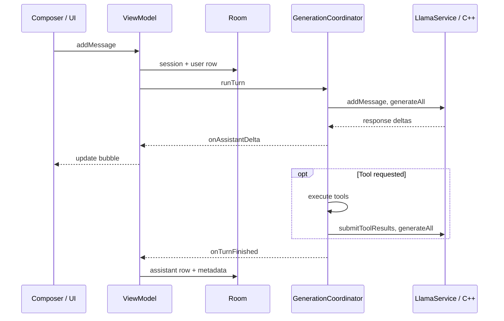

# 01 — Send a message in Nagasa

We tap Send, watch an answer grow in its bubble, and expect that answer to still be there when we reopen the chat.

Let's follow “Explain why the sky is blue.” We have already loaded a local GGUF model, a file containing the model's weights and metadata. We will take the text-only path first, then follow its tool-call detour. Cloud selection takes a different branch; this chapter does not pretend that cloud inference runs through llama.cpp.

This walkthrough is pinned to `eb46dfb`. **We decided** labels an intention recorded in repository documentation or source comments. **We think** labels our interpretation or a question worth testing. The snippets are short excerpts, not replacement implementations. This is a source walkthrough, not a report of a device run.

## 1. Send does not choose a model

In [UserInput](https://github.com/xdutsuay/chidori-nagasa/blob/eb46dfb/app/src/main/java/com/druk/lmplayground/conversation/UserInput.kt#L475), Send is enabled only when the composer is idle and the text is nonblank:

```kotlin
enabled = sendMessageEnabled && status == UserInputStatus.IDLE,
onClick = onMessageSent,
```

The [fragment's status mapping](https://github.com/xdutsuay/chidori-nagasa/blob/eb46dfb/app/src/main/java/com/druk/lmplayground/conversation/ConversationFragment.kt#L809) makes an unloaded local model `NOT_LOADED`. Selecting a model happens earlier through [the model-picker callback](https://github.com/xdutsuay/chidori-nagasa/blob/eb46dfb/app/src/main/java/com/druk/lmplayground/conversation/ConversationFragment.kt#L895), which calls `ConversationViewModel.loadModel(model)`. Send uses the selected engine; it does not load one for every message.

What did loading prepare? [ConversationViewModel.loadModel](https://github.com/xdutsuay/chidori-nagasa/blob/eb46dfb/app/src/main/java/com/druk/lmplayground/conversation/ConversationViewModel.kt#L540) clears the cloud route, checks the RAM warning, resolves a vision projector if present, and delegates:

```kotlin
runtime.loadModel(model, disableRepack = !repackEnabled) { uiState.messages.toList() }
```

[ModelRuntime.loadModel](https://github.com/xdutsuay/chidori-nagasa/blob/eb46dfb/app/src/main/java/com/druk/lmplayground/inference/ModelRuntime.kt#L166) cancels old generation, destroys the old session, unloads the old model and closes its descriptor. Then it opens the chosen document. It restores saved generation parameters and [creates a session](https://github.com/xdutsuay/chidori-nagasa/blob/eb46dfb/app/src/main/java/com/druk/lmplayground/inference/ModelRuntime.kt#L315):

```kotlin
val llamaSession = createSessionWithParams(llamaModel, params, "")
```

A *model* holds weights; a *session* holds this conversation's inference context and sampling state. Context includes the KV cache: intermediate attention calculations we can reuse instead of processing the same prefix again. [History replay precedes readiness](https://github.com/xdutsuay/chidori-nagasa/blob/eb46dfb/app/src/main/java/com/druk/lmplayground/inference/ModelRuntime.kt#L350), so accepting a follow-up should not race reconstruction of the earlier conversation.

**We decided:** ownership is split between ViewModel, ModelRuntime and GenerationCoordinator in [Architecture](https://github.com/xdutsuay/chidori-nagasa/blob/eb46dfb/ARCHITECTURE.md#L22). **We think:** that split becomes easier to understand if we ask three different questions: what should the screen show, which engine resources exist, and what is this turn doing?

## 2. One tap creates two visible messages

[UserInput's callback](https://github.com/xdutsuay/chidori-nagasa/blob/eb46dfb/app/src/main/java/com/druk/lmplayground/conversation/UserInput.kt#L262) passes the text upward and clears the composer:

```kotlin
onMessageSent(textState.text)
textState = TextFieldValue()
```

[ConversationFragment](https://github.com/xdutsuay/chidori-nagasa/blob/eb46dfb/app/src/main/java/com/druk/lmplayground/conversation/ConversationFragment.kt#L834) wraps it in `Message("User", content)` and calls `viewModel.addMessage`. [That method](https://github.com/xdutsuay/chidori-nagasa/blob/eb46dfb/app/src/main/java/com/druk/lmplayground/conversation/ConversationViewModel.kt#L739) checks the source before taking the local branch:

```kotlin
if (_activeCloudSource.value != null) {
    addCloudMessage(message)
    return
}
addLocalMessage(message, imageUri)
```

[addLocalMessage](https://github.com/xdutsuay/chidori-nagasa/blob/eb46dfb/app/src/main/java/com/druk/lmplayground/conversation/ConversationViewModel.kt#L760) rejects oversized text before adding bubbles. This estimates the string's transport size as `message.content.length * 2`; it is not a token count. Binder, Android's cross-process messaging mechanism, has a different limit from the model's context window.

The method then adds the user bubble and an empty assistant placeholder inside a Compose snapshot, a controlled update to observable UI state. It marks generation active and remembers the placeholder's stable `Message.id`. Later cleanup uses that identity so an old turn cannot finalize a newer turn's bubble.

**We think:** “shown” and “saved” are already different states. Neither adding a bubble nor clearing the composer proves a database write succeeded.

## 3. Save the question before asking the engine

The [generation coroutine](https://github.com/xdutsuay/chidori-nagasa/blob/eb46dfb/app/src/main/java/com/druk/lmplayground/conversation/ConversationViewModel.kt#L803) first establishes the persisted chat and inserts its user message:

```kotlin
val sessionId = ensureSession(message)
sessionStore.persistMessage(sessionId, userMessage, persistedImageFile?.absolutePath)
```

[ensureSession](https://github.com/xdutsuay/chidori-nagasa/blob/eb46dfb/app/src/main/java/com/druk/lmplayground/conversation/ConversationViewModel.kt#L949) reuses the current session ID or calls [ChatSessionStore.createSession](https://github.com/xdutsuay/chidori-nagasa/blob/eb46dfb/app/src/main/java/com/druk/lmplayground/conversation/ChatSessionStore.kt#L47). The latter creates a UUID, takes the first 50 characters as the title, and stores model identity, generation settings and system prompt in a session row. This database session is not the native inference session we just met. They share a purpose, not an allocation or lifetime.

Only after that write does the ViewModel call `generation.runTurn`. Here is our route, with the optional loop collapsed so we can keep the whole journey in view:



## 4. Cross a process boundary, then a language boundary

**We decided:** release builds put native inference in `:llama`, separate from the UI process, so a native crash need not kill the screen. Debug builds run the service in-process. That distinction is documented in [Architecture](https://github.com/xdutsuay/chidori-nagasa/blob/eb46dfb/ARCHITECTURE.md#L7).

[LlamaCpp.loadModel](https://github.com/xdutsuay/chidori-nagasa/blob/eb46dfb/app/src/main/java/com/druk/llamacpp/LlamaCpp.kt#L42) is an app-side proxy, not the native loader:

```kotlin
val id = client.withService { it.loadModel(null, pfd, wrapProgress(progressCallback), disableRepack) }
```

The file descriptor crosses Binder because a user-chosen Android document need not have an ordinary filesystem path. [LlamaService.loadModel](https://github.com/xdutsuay/chidori-nagasa/blob/eb46dfb/app/src/main/java/com/druk/lmplayground/inference/LlamaService.kt#L232) resolves it, calls `nativeLlamaCpp.loadModel`, and stores the result under an integer model ID. The phone's UI passes IDs, not C++ pointers.

Now JNI—the Java Native Interface—crosses from Kotlin's runtime into C++. The [native load entry point](https://github.com/xdutsuay/chidori-nagasa/blob/eb46dfb/app/src/main/cpp/native-lib.cpp#L234) allocates the wrapper and eventually installs its pointer in the Kotlin native object's `nativeHandle`:

```cpp
auto model = std::make_unique<LlamaModel>();
```

[LlamaModel::loadModel](https://github.com/xdutsuay/chidori-nagasa/blob/eb46dfb/app/src/main/cpp/LlamaModel.cpp#L73) reaches llama.cpp's `llama_model_load_from_file`. [Session creation through JNI](https://github.com/xdutsuay/chidori-nagasa/blob/eb46dfb/app/src/main/cpp/native-lib.cpp#L370) turns Kotlin settings into `SamplerParams` and calls `createGenerationSession`. The [C++ session initialization](https://github.com/xdutsuay/chidori-nagasa/blob/eb46dfb/app/src/main/cpp/LlamaGenerationSession.cpp#L143) allocates its context with `llama_init_from_model`.

**We think:** the extra layers buy crash containment and explicit ownership. They also make every cancellation, error and string-size limit a cross-boundary contract we must maintain.

## 5. Build the model's input, not just its visible bubble

[GenerationCoordinator.runTurn](https://github.com/xdutsuay/chidori-nagasa/blob/eb46dfb/app/src/main/java/com/druk/lmplayground/conversation/GenerationCoordinator.kt#L96) runs engine work on `Dispatchers.Default`. It refreshes tool enablement from preferences, checks model capability, prepares the preamble cache, and calls:

```kotlin
llamaSession.addMessage(CosPromptNote.withTurnUpdate(content, cosUpdate?.first), enableThinking)
```

That [call site](https://github.com/xdutsuay/chidori-nagasa/blob/eb46dfb/app/src/main/java/com/druk/lmplayground/conversation/GenerationCoordinator.kt#L183) explains a subtle difference: a changed Computer state can add a note to model input without rewriting the user's stored message. With an image, the coordinator first obtains resized bytes and calls `setImageData`; our plain-text example skips that path.

In [C++ addMessage](https://github.com/xdutsuay/chidori-nagasa/blob/eb46dfb/app/src/main/cpp/LlamaGenerationSession.cpp#L273), the user message joins native history and the model's chat template renders the prompt:

```cpp
messages.push_back(user_msg);
```

The native path compares that rendered prompt with the reusable prefix, clearing KV state on mismatch. It tokenizes the remaining input and invokes [compactContextIfNeeded](https://github.com/xdutsuay/chidori-nagasa/blob/eb46dfb/app/src/main/cpp/LlamaGenerationSession.cpp#L368) before building the batch. The database's complete history and the finite working context are therefore different things.

[PreambleCacheManager.apply](https://github.com/xdutsuay/chidori-nagasa/blob/eb46dfb/app/src/main/java/com/druk/lmplayground/conversation/PreambleCacheManager.kt#L26) adds another distinction: reusable system-prompt/tool-prefix calculations can live on disk under `filesDir/kv_preamble`. [Its pruner](https://github.com/xdutsuay/chidori-nagasa/blob/eb46dfb/app/src/main/java/com/druk/lmplayground/conversation/PreambleCacheManager.kt#L55) removes old bin/JSON pairs. Ending a turn does not delete this cache or the downloaded GGUF.

## 6. A token travels back through the layers

The [proxy's generateAll](https://github.com/xdutsuay/chidori-nagasa/blob/eb46dfb/app/src/main/java/com/druk/llamacpp/LlamaGenerationSession.kt#L144) starts service generation and suspends until completion. [LlamaService.startGeneration](https://github.com/xdutsuay/chidori-nagasa/blob/eb46dfb/app/src/main/java/com/druk/lmplayground/inference/LlamaService.kt#L385) owns the service-side worker arrangement. [GenerationWorker](https://github.com/xdutsuay/chidori-nagasa/blob/eb46dfb/app/src/main/java/com/druk/lmplayground/inference/GenerationWorker.kt#L86) repeatedly calls the native session:

```kotlin
val rc = nativeSession.generate(nativeCallback)
if (rc == 0) continue
statusCode = if (rc == 1) 0 else rc
```

There are two status conventions here. Native zero means *keep sampling*. Service zero means *finished normally*. Native two means tool calls are waiting.

The [JNI generate entry point](https://github.com/xdutsuay/chidori-nagasa/blob/eb46dfb/app/src/main/cpp/native-lib.cpp#L420) calls [LlamaGenerationSession::generate](https://github.com/xdutsuay/chidori-nagasa/blob/eb46dfb/app/src/main/cpp/LlamaGenerationSession.cpp#L650). C++ decodes prompt/token batches, samples a token, converts it into text, and calls back with the accumulated response. A token is a model vocabulary item, not necessarily a whole word or displayable character.

**We decided:** [GenerationWorker's documented transport contract](https://github.com/xdutsuay/chidori-nagasa/blob/eb46dfb/app/src/main/java/com/druk/lmplayground/inference/GenerationWorker.kt#L11) sends only newly appended text across Binder:

```kotlin
val delta = response.substring(sentLength)
sentLength = response.length
try {
    cb.onResponseDelta(delta)
} catch (e: RemoteException) {
    cancelled = true
}
```

The app-side proxy [reassembles the full string](https://github.com/xdutsuay/chidori-nagasa/blob/eb46dfb/app/src/main/java/com/druk/llamacpp/LlamaGenerationSession.kt#L152). **We think:** that saves transport bytes, but it assumes each response preserves its previous prefix. The [C++ parser comment](https://github.com/xdutsuay/chidori-nagasa/blob/eb46dfb/app/src/main/cpp/LlamaGenerationSession.cpp#L758) explicitly guards against switching from raw control markup to normalized text midway through streaming. “Streaming” is a consistency rule, not just a visual effect.

## 7. Update the bubble; sometimes take a tool detour

The coordinator's [onFullResponse](https://github.com/xdutsuay/chidori-nagasa/blob/eb46dfb/app/src/main/java/com/druk/lmplayground/conversation/GenerationCoordinator.kt#L214) processes the text and separates thinking/output counters. The ViewModel's [onAssistantDelta](https://github.com/xdutsuay/chidori-nagasa/blob/eb46dfb/app/src/main/java/com/druk/lmplayground/conversation/ConversationViewModel.kt#L227) updates observable state inside a snapshot. [ConversationUiState.updateLastMessage](https://github.com/xdutsuay/chidori-nagasa/blob/eb46dfb/app/src/main/java/com/druk/lmplayground/conversation/ConversationUiState.kt#L29) replaces the last message with a copy:

```kotlin
content = msg,
```

The [fragment reads that message list](https://github.com/xdutsuay/chidori-nagasa/blob/eb46dfb/app/src/main/java/com/druk/lmplayground/conversation/ConversationFragment.kt#L223) and [passes it to Messages](https://github.com/xdutsuay/chidori-nagasa/blob/eb46dfb/app/src/main/java/com/druk/lmplayground/conversation/ConversationFragment.kt#L631). Compose can redraw the bubble. These streaming updates do not insert an assistant database row each time.

If native generation returns two, the [coordinator's loop](https://github.com/xdutsuay/chidori-nagasa/blob/eb46dfb/app/src/main/java/com/druk/lmplayground/conversation/GenerationCoordinator.kt#L284) fetches tool-call JSON and delegates to [ToolCallRunner.run](https://github.com/xdutsuay/chidori-nagasa/blob/eb46dfb/app/src/main/java/com/druk/lmplayground/conversation/ToolCallRunner.kt#L28). That runner uses `Dispatchers.IO`; [ToolRegistry.executeToolCalls](https://github.com/xdutsuay/chidori-nagasa/blob/eb46dfb/app/src/main/java/com/druk/lmplayground/tools/ToolRegistry.kt#L78) dispatches the actual calls. The coordinator attaches result cards, submits results to the native session, and generates again:

```kotlin
llamaSession.submitToolResults(prepared.resultsJson, responseThinking)
```

[The loop](https://github.com/xdutsuay/chidori-nagasa/blob/eb46dfb/app/src/main/java/com/druk/lmplayground/conversation/GenerationCoordinator.kt#L349) permits up to five executed tool rounds. At the limit, pending calls receive recorded failure results instead of being left unanswered. [ConversationUiState.addToolCallsToLastMessage](https://github.com/xdutsuay/chidori-nagasa/blob/eb46dfb/app/src/main/java/com/druk/lmplayground/conversation/ConversationUiState.kt#L57) moves preceding text into the tool-card history and clears the response area for the next round.

**We think:** tools turn one answer into several inference phases, but the app still persists their cards together with one assistant message. Also, local inference does not imply every enabled tool is network-free.

## 8. Stop means finish safely, not unload everything

The button calls [ConversationViewModel.cancelGeneration](https://github.com/xdutsuay/chidori-nagasa/blob/eb46dfb/app/src/main/java/com/druk/lmplayground/conversation/ConversationViewModel.kt#L1259):

```kotlin
runtime.generatingJob?.cancel()
```

While awaiting inference, [generateAll's cancellation handler](https://github.com/xdutsuay/chidori-nagasa/blob/eb46dfb/app/src/main/java/com/druk/llamacpp/LlamaGenerationSession.kt#L177) requests service cancellation, waits up to 30 seconds for the worker's completion signal, then rethrows cancellation. [GenerationWorker.cancel](https://github.com/xdutsuay/chidori-nagasa/blob/eb46dfb/app/src/main/java/com/druk/lmplayground/inference/GenerationWorker.kt#L130) also calls `requestAbort`, so prompt evaluation can notice Stop inside native work.

**We decided:** the [proxy's comment](https://github.com/xdutsuay/chidori-nagasa/blob/eb46dfb/app/src/main/java/com/druk/llamacpp/LlamaGenerationSession.kt#L131) explains the wait: otherwise late tokens could arrive after the partial answer was finalized and saved. This is a bounded drain, not a promise of instantaneous cancellation.

During a tool call, [ToolCallRunner](https://github.com/xdutsuay/chidori-nagasa/blob/eb46dfb/app/src/main/java/com/druk/lmplayground/conversation/ToolCallRunner.kt#L40) repeatedly cancels in-flight work until it joins, records cancelled results, and rethrows. **We think:** preserving “this action was cancelled” matters as much as stopping the action; the next model turn must not inherit an unanswered tool request.

## 9. Finally, make the answer durable

The [coordinator's finally block](https://github.com/xdutsuay/chidori-nagasa/blob/eb46dfb/app/src/main/java/com/druk/lmplayground/conversation/GenerationCoordinator.kt#L377) runs turn finalization in `NonCancellable`, including after Stop:

```kotlin
withContext(NonCancellable) {
    try { llamaSession.printReport() } catch (_: Throwable) {}
    listener.onTurnFinished(ourJob, messageId, sessionId, callback.totalTokens)
}
```

[onTurnFinished](https://github.com/xdutsuay/chidori-nagasa/blob/eb46dfb/app/src/main/java/com/druk/lmplayground/conversation/ConversationViewModel.kt#L272) checks both job ownership and placeholder identity, finalizes timing, clears the generating indicator, and attempts to persist whatever answer exists—including a partial answer. [ChatSessionStore.persistMessage](https://github.com/xdutsuay/chidori-nagasa/blob/eb46dfb/app/src/main/java/com/druk/lmplayground/conversation/ChatSessionStore.kt#L93) converts UI state into `ChatMessageEntity`, including timings, counts and serialized tool cards. [ChatRepository.insertMessage](https://github.com/xdutsuay/chidori-nagasa/blob/eb46dfb/app/src/main/java/com/druk/lmplayground/data/ChatRepository.kt#L15) delegates to [ChatDao.insertMessage](https://github.com/xdutsuay/chidori-nagasa/blob/eb46dfb/app/src/main/java/com/druk/lmplayground/data/ChatDao.kt#L21):

```kotlin
@Insert
suspend fun insertMessage(message: ChatMessageEntity)
```

Room, Android's SQLite mapping library, writes that entity into [chat_messages](https://github.com/xdutsuay/chidori-nagasa/blob/eb46dfb/app/src/main/java/com/druk/lmplayground/data/ChatMessageEntity.kt#L8), in [lmplayground.db](https://github.com/xdutsuay/chidori-nagasa/blob/eb46dfb/app/src/main/java/com/druk/lmplayground/data/AppDatabase.kt#L165). Session timestamp and web-link metadata updates follow the assistant insert.

**We think:** here is the durability gap worth noticing. [Persistence exceptions are swallowed](https://github.com/xdutsuay/chidori-nagasa/blob/eb46dfb/app/src/main/java/com/druk/lmplayground/conversation/ConversationViewModel.kt#L332), and the ready notification is updated before the insert. A finished-looking answer is not proof of a saved answer. A hard process kill also bypasses coroutine finally blocks; there is no per-token assistant checkpoint in this path.

## Data lifecycle

| Resource | Created | Stored / cached | Deleted or cleaned up | Who owns cancel |
| --- | --- | --- | --- | --- |
| Visible user + empty assistant bubbles | `addLocalMessage` | Compose `uiState` | Next turn / clear chat | UI thread via ViewModel |
| User `ChatMessageEntity` | `persistMessage` before `runTurn` | Room `chat_messages` | Cascade delete with session | N/A (sync write) |
| Assistant row (final or partial) | `onTurnFinished` → `persistMessage` | Room | Cascade delete | `NonCancellable` finalization |
| Native model + session + KV cache | `ModelRuntime.loadModel` | `:llama` process heap | `unloadNative` / `shutdown` | `generatingJob.cancel` then drain |
| ParcelFileDescriptor to GGUF | open during load | held by ModelRuntime | closed after unload | load/unload path |
| Tool-call cards on the message | `addToolCallsToLastMessage` | UI then serialized into assistant row | with message | `ToolCallRunner` cancel loop |

Normal completion leaves model and native session loaded for the next question. Their explicit owner is [ModelRuntime.unloadNative](https://github.com/xdutsuay/chidori-nagasa/blob/eb46dfb/app/src/main/java/com/druk/lmplayground/inference/ModelRuntime.kt#L629), or [shutdown](https://github.com/xdutsuay/chidori-nagasa/blob/eb46dfb/app/src/main/java/com/druk/lmplayground/inference/ModelRuntime.kt#L653) when [the ViewModel clears](https://github.com/xdutsuay/chidori-nagasa/blob/eb46dfb/app/src/main/java/com/druk/lmplayground/conversation/ConversationViewModel.kt#L512). Teardown cancels generation, destroys the session, unloads the model, then closes the file descriptor. [The native session destructor](https://github.com/xdutsuay/chidori-nagasa/blob/eb46dfb/app/src/main/cpp/LlamaGenerationSession.cpp#L81) calls `llama_free` and frees the sampler; [model unload](https://github.com/xdutsuay/chidori-nagasa/blob/eb46dfb/app/src/main/cpp/LlamaModel.cpp#L215) calls `llama_model_free`. Managed garbage collection is not a substitute for those native releases, nor does it erase database rows or files.

## Known gaps

- Ready notification can fire before the assistant insert completes, and insert errors are swallowed ([ConversationViewModel](https://github.com/xdutsuay/chidori-nagasa/blob/eb46dfb/app/src/main/java/com/druk/lmplayground/conversation/ConversationViewModel.kt#L332)).
- Hard process death skips coroutine `finally`; there is no per-token assistant checkpoint on this path.
- [StoppedToolRoundTest](https://github.com/xdutsuay/chidori-nagasa/blob/eb46dfb/app/src/test/java/com/druk/lmplayground/conversation/StoppedToolRoundTest.kt#L130) proves history bookkeeping under Stop, not that a real worker or proot PID died.

## Try it

Trace our sky question with tools disabled. At each arrow in the diagram, write down which of these exists: visible text, committed user row, committed assistant row, native context. Now predict what reopening shows if the process dies halfway through the response, versus after pressing Stop and allowing cleanup to finish.

Then read [StoppedToolRoundTest](https://github.com/xdutsuay/chidori-nagasa/blob/eb46dfb/app/src/test/java/com/druk/lmplayground/conversation/StoppedToolRoundTest.kt#L130). Explain why its fake history test is useful, and why it cannot prove a real Android worker or proot process actually stopped. Finally, find the two identity checks in `onTurnFinished`: what newer state could an old callback damage if we removed them?
