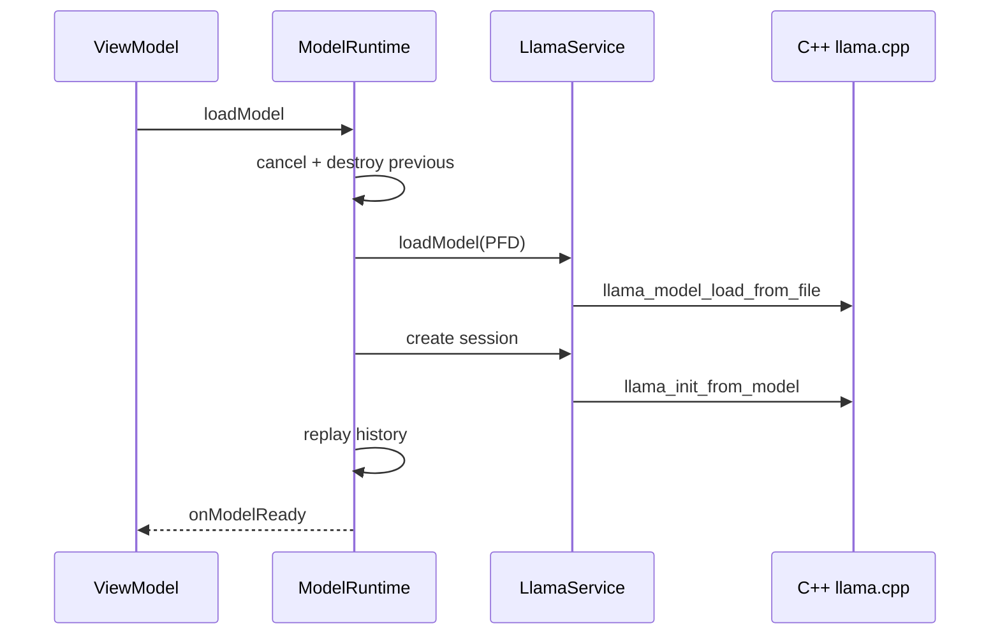

# 02 — Inference and model lifecycle

We pick a GGUF from Storage, wait for “Model is loaded,” ask a question, then later unload or switch models — and we expect RAM and file descriptors to come back when we leave.

This chapter stays on the local engine path. It does not re-walk every token of a chat turn; [01 — Send a message](01-send-a-message.md) already does that. Here we follow ownership of the model file, the native weights, the session context, and the process that holds them. Pinned to `eb46dfb`.

## 1. Load clears the previous world first

[ConversationViewModel.loadModel](https://github.com/xdutsuay/chidori-nagasa/blob/eb46dfb/app/src/main/java/com/druk/lmplayground/conversation/ConversationViewModel.kt#L540) is the UI entry. It clears any active cloud route, may warn about RAM, resolves a vision projector path, then calls:

```kotlin
runtime.loadModel(model, disableRepack = !repackEnabled) { uiState.messages.toList() }
```

[ModelRuntime.loadModel](https://github.com/xdutsuay/chidori-nagasa/blob/eb46dfb/app/src/main/java/com/druk/lmplayground/inference/ModelRuntime.kt#L166) cancels in-flight generation, nulls the previous session/model/handle on the main thread, then destroys and unloads them on `Dispatchers.Default` before opening anything new:

```kotlin
prevSession?.destroy()
prevModel?.unloadModel()
```

Only after that does it call [StorageRepository.openModelFile](https://github.com/xdutsuay/chidori-nagasa/blob/eb46dfb/app/src/main/java/com/druk/lmplayground/storage/StorageRepository.kt#L191) and keep the ParcelFileDescriptor in `modelFileHandle`. The PFD crosses Binder into `:llama` because a SAF document need not have a normal path.

**We decided:** release builds isolate native inference in `:llama` so a native crash need not kill the UI process ([Architecture](https://github.com/xdutsuay/chidori-nagasa/blob/eb46dfb/ARCHITECTURE.md#L7)). Debug builds keep the service in-process.

## 2. A model is not a session

After [LlamaCpp.loadModel](https://github.com/xdutsuay/chidori-nagasa/blob/eb46dfb/app/src/main/java/com/druk/llamacpp/LlamaCpp.kt#L42) returns a proxy, ModelRuntime restores saved [GenerationParams](https://github.com/xdutsuay/chidori-nagasa/blob/eb46dfb/app/src/main/java/com/druk/lmplayground/inference/ModelRuntime.kt#L316) and calls `createSessionWithParams`. Failure to create a session unloads the fresh model immediately:

```kotlin
if (llamaSession == null) {
    listener.onLoadStatus("Failed to create session")
    llamaModel.unloadModel()
    return@withContext
}
```

Ownership is assigned only after that check ([line 333](https://github.com/xdutsuay/chidori-nagasa/blob/eb46dfb/app/src/main/java/com/druk/lmplayground/inference/ModelRuntime.kt#L333)). History replay then runs before `onModelReady`, so a follow-up cannot race an empty context ([line 350](https://github.com/xdutsuay/chidori-nagasa/blob/eb46dfb/app/src/main/java/com/druk/lmplayground/inference/ModelRuntime.kt#L350)).



## 3. What stays alive between turns

A successful load leaves: the SAF/file descriptor, native model weights (often mmap'd), a generation session with KV cache and sampler, and the foreground-service notification path in [LlamaService](https://github.com/xdutsuay/chidori-nagasa/blob/eb46dfb/app/src/main/java/com/druk/lmplayground/inference/LlamaService.kt#L257). Backgrounding the app is not unload. Stop cancels generation; it does not free the model ([01](01-send-a-message.md) §8).

Optional disk state also appears: preamble KV under `filesDir/kv_preamble` via [PreambleCacheManager](https://github.com/xdutsuay/chidori-nagasa/blob/eb46dfb/app/src/main/java/com/druk/lmplayground/conversation/PreambleCacheManager.kt#L26), and a temporary mmproj copy under `cacheDir` that load tries to delete after use ([ModelRuntime](https://github.com/xdutsuay/chidori-nagasa/blob/eb46dfb/app/src/main/java/com/druk/lmplayground/inference/ModelRuntime.kt#L279)).

## 4. Unload and shutdown are explicit

[ModelRuntime.unloadNative](https://github.com/xdutsuay/chidori-nagasa/blob/eb46dfb/app/src/main/java/com/druk/lmplayground/inference/ModelRuntime.kt#L629) cancels generation, destroys the session, unloads the model, then closes the descriptor. [shutdown](https://github.com/xdutsuay/chidori-nagasa/blob/eb46dfb/app/src/main/java/com/druk/lmplayground/inference/ModelRuntime.kt#L653) is the ViewModel-clear path. Native destructors call `llama_free` / `llama_model_free` ([LlamaGenerationSession.cpp](https://github.com/xdutsuay/chidori-nagasa/blob/eb46dfb/app/src/main/cpp/LlamaGenerationSession.cpp#L81), [LlamaModel.cpp](https://github.com/xdutsuay/chidori-nagasa/blob/eb46dfb/app/src/main/cpp/LlamaModel.cpp#L215)). Managed GC does not replace those releases.

Node mode creates a temporary session for a one-shot completion and destroys it in [nodeModeComplete](https://github.com/xdutsuay/chidori-nagasa/blob/eb46dfb/app/src/main/java/com/druk/lmplayground/inference/ModelRuntime.kt#L676) ([temp.destroy](https://github.com/xdutsuay/chidori-nagasa/blob/eb46dfb/app/src/main/java/com/druk/lmplayground/inference/ModelRuntime.kt#L707)). That path must not leave a second long-lived context beside the chat session.

**We decided:** ViewModel owns UI and persistence; ModelRuntime owns engine proxies and the descriptor; LlamaService owns native handles and workers ([Architecture](https://github.com/xdutsuay/chidori-nagasa/blob/eb46dfb/ARCHITECTURE.md#L22)). **We think:** asking “who closes the PFD?” and “who calls llama_model_free?” separately catches more bugs than asking “is the model unloaded?”

## Data lifecycle

| What | Created | Cleaned by |
|------|---------|------------|
| ParcelFileDescriptor / SAF grant | `openModelFile` during load | `unloadNative` / `shutdown` close |
| Native model + session | JNI load + `createGenerationSession` | `destroy` / `unloadModel` / C++ destructors |
| KV cache / sampler | session init | session destroy |
| Preamble bin/JSON | `PreambleCacheManager.apply` | pruner, not per-turn end |
| mmproj temp file | vision load copy | delete after load (best-effort) |
| FGS notification | service while model loaded | cleared on unload path |

Cancellation of a load is a coroutine cancel into the load `withContext`; the catch closes the newly opened `fileHandle`. Process death skips finally blocks — there is no durable “half-loaded” checkpoint.

## Tradeoffs

**We decided:** Binder carries a file descriptor and integer IDs, not C++ pointers ([Architecture](https://github.com/xdutsuay/chidori-nagasa/blob/eb46dfb/ARCHITECTURE.md#L66)). That contains crashes and makes ownership explicit across processes. **We think:** every failure branch between “PFD opened” and “session assigned to fields” must still free whatever it already allocated; the catch at [line 374](https://github.com/xdutsuay/chidori-nagasa/blob/eb46dfb/app/src/main/java/com/druk/lmplayground/inference/ModelRuntime.kt#L374) is the main safety net and is not a full inventory of every local.

## Known gaps

- **Load failure cleanup is incomplete in some branches (static review).** The outer catch closes `fileHandle` but does not always unload a local `llamaModel` that failed after native load and before field assignment ([ModelRuntime.kt:374](https://github.com/xdutsuay/chidori-nagasa/blob/eb46dfb/app/src/main/java/com/druk/lmplayground/inference/ModelRuntime.kt#L374)). Payload-too-large replay does tear down ([362](https://github.com/xdutsuay/chidori-nagasa/blob/eb46dfb/app/src/main/java/com/druk/lmplayground/inference/ModelRuntime.kt#L362)). Needs fault injection, not proven as a leak on device.
- Stopping generation does not unload. That is intentional, but easy to misread as a leak when looking at RSS after Stop.

## Try it

Load a small GGUF, send one short question, press Stop mid-answer, then unload from the UI. For each step, write which of these still exist: PFD, native model, native session, Room rows, preamble cache files. Predict what a `:llama` process crash mid-generation does to the UI process, using [Architecture](https://github.com/xdutsuay/chidori-nagasa/blob/eb46dfb/ARCHITECTURE.md#L7) as the claim to verify — not as a substitute for a crash test.
