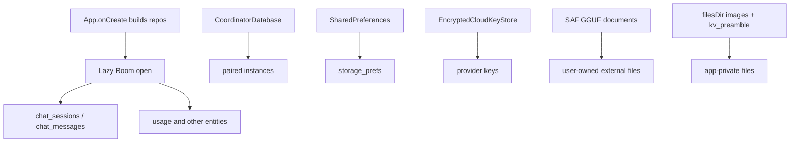

# 03 — Storage and data lifecycle

We save chats, download models, store API keys, and later hit Delete — and we expect the right things to vanish while the wrong things stay.

This chapter follows durable stores in Nagasa: Room databases, SharedPreferences, encrypted prefs, SAF documents, and app-private files. Pinned to `eb46dfb`. It is not a claim that Android “Clear storage” is implemented inside the app.

## 1. Construction is not creation

[App.onCreate](https://github.com/xdutsuay/chidori-nagasa/blob/eb46dfb/app/src/main/java/com/druk/lmplayground/App.kt#L69) builds repositories. Room opens lazily through [AppDatabase.getInstance](https://github.com/xdutsuay/chidori-nagasa/blob/eb46dfb/app/src/main/java/com/druk/lmplayground/data/AppDatabase.kt#L165):

```kotlin
val database = AppDatabase.getInstance(this)
chatRepository = ChatRepository(database.chatDao())
```

[AppDatabase](https://github.com/xdutsuay/chidori-nagasa/blob/eb46dfb/app/src/main/java/com/druk/lmplayground/data/AppDatabase.kt#L12) declares six entities at schema version 9 with migrations from earlier versions ([lines 38–161](https://github.com/xdutsuay/chidori-nagasa/blob/eb46dfb/app/src/main/java/com/druk/lmplayground/data/AppDatabase.kt#L38)). Pairing uses a separate database: [CoordinatorDatabase](https://github.com/xdutsuay/chidori-nagasa/blob/eb46dfb/app/src/main/java/com/druk/lmplayground/coordinator/pairing/data/CoordinatorDatabase.kt#L28). Settings live in SharedPreferences via [StoragePreferences](https://github.com/xdutsuay/chidori-nagasa/blob/eb46dfb/app/src/main/java/com/druk/lmplayground/storage/StoragePreferences.kt#L14) — there is no DataStore under `app/src/main` at this pin.

**We decided:** engine and Room ownership stay split ([Architecture](https://github.com/xdutsuay/chidori-nagasa/blob/eb46dfb/ARCHITECTURE.md#L11)). **We think:** “the app’s database” is already plural; retention questions must name which store.

## 2. A chat row’s life

Sending a message writes the session and user row before inference ([01](01-send-a-message.md) §3). The assistant row is inserted at turn finalization through [ChatSessionStore.persistMessage](https://github.com/xdutsuay/chidori-nagasa/blob/eb46dfb/app/src/main/java/com/druk/lmplayground/conversation/ChatSessionStore.kt#L93) → [ChatDao.insertMessage](https://github.com/xdutsuay/chidori-nagasa/blob/eb46dfb/app/src/main/java/com/druk/lmplayground/data/ChatDao.kt#L22). [ChatMessageEntity](https://github.com/xdutsuay/chidori-nagasa/blob/eb46dfb/app/src/main/java/com/druk/lmplayground/data/ChatMessageEntity.kt#L8) cascades with its session.

Deleting a chat calls [ChatSessionStore.deleteSession](https://github.com/xdutsuay/chidori-nagasa/blob/eb46dfb/app/src/main/java/com/druk/lmplayground/conversation/ChatSessionStore.kt#L233), which removes attachment files first, then [ChatDao.deleteSession](https://github.com/xdutsuay/chidori-nagasa/blob/eb46dfb/app/src/main/java/com/druk/lmplayground/data/ChatDao.kt#L58). Guest files created by COS tools are not part of that cascade ([07](07-restart-deletion-cleanup.md)).



## 3. Models, downloads, keys, images

[DownloadRepository.startDownload](https://github.com/xdutsuay/chidori-nagasa/blob/eb46dfb/app/src/main/java/com/druk/lmplayground/download/DownloadRepository.kt#L35) enqueues WorkManager work into a user-chosen storage URI. [cancelDownload](https://github.com/xdutsuay/chidori-nagasa/blob/eb46dfb/app/src/main/java/com/druk/lmplayground/download/DownloadRepository.kt#L101) removes partial downloads on cancel. [StorageRepository.deleteModel](https://github.com/xdutsuay/chidori-nagasa/blob/eb46dfb/app/src/main/java/com/druk/lmplayground/storage/StorageRepository.kt#L141) deletes a tracked model file; [StorageViewModel.deleteModel(ModelInfo)](https://github.com/xdutsuay/chidori-nagasa/blob/eb46dfb/app/src/main/java/com/druk/lmplayground/storage/StorageViewModel.kt#L169) also deletes a declared projector. A user-chosen external GGUF under SAF is not “inside” Room — deleting the app’s index entry is not the same as Android reclaiming an external document.

[EncryptedCloudKeyStore](https://github.com/xdutsuay/chidori-nagasa/blob/eb46dfb/app/src/main/java/com/druk/lmplayground/cloud/EncryptedCloudKeyStore.kt#L48) wraps encrypted SharedPreferences for provider credentials. [StoragePreferences.clear](https://github.com/xdutsuay/chidori-nagasa/blob/eb46dfb/app/src/main/java/com/druk/lmplayground/storage/StoragePreferences.kt#L181) clears settings prefs only — not Room, not COS rootfs, not pairing DB.

Chat images are copied into app storage by [ChatImageStore.persistImageFile](https://github.com/xdutsuay/chidori-nagasa/blob/eb46dfb/app/src/main/java/com/druk/lmplayground/conversation/ChatImageStore.kt#L28) when a message is sent. Preamble cache pairs are pruned by [PreambleCacheManager](https://github.com/xdutsuay/chidori-nagasa/blob/eb46dfb/app/src/main/java/com/druk/lmplayground/conversation/PreambleCacheManager.kt#L55).

**We decided:** SAF for model documents ([Architecture](https://github.com/xdutsuay/chidori-nagasa/blob/eb46dfb/ARCHITECTURE.md#L66)); schema migrations document intent in [AppDatabase](https://github.com/xdutsuay/chidori-nagasa/blob/eb46dfb/app/src/main/java/com/druk/lmplayground/data/AppDatabase.kt#L62). **We think:** persistence is several independently cleaned stores, not one transaction across delete-chat / delete-model / clear-prefs / OS clear-data.

## Data lifecycle

| Store | Created when | Deleted / retained by |
|-------|--------------|------------------------|
| `lmplayground.db` rows | first write after open | `deleteSession`, migrations; OS clear-data |
| Pairing DB + token | successful pair | `unpair` / local delete even if remote revoke fails |
| `storage_prefs` | preference writes | `StoragePreferences.clear` |
| Encrypted provider keys | key save | `deleteKey` / clear of that prefs file |
| SAF GGUF | user download or pick | `deleteModel` / user in Files; may survive app data clear |
| Chat image files | `persistImageFile` | session delete of attachments |
| `kv_preamble` | preamble apply | pruner |
| Native model/session | load | unload — not Room |

JVM GC reclaims unreachable managed objects only. Integer native handles and files are not GC problems.

## Tradeoffs

**We decided** to keep chat history in Room with cascading deletes, and model blobs on user-chosen storage. That avoids packing multi-GB weights into the app database. **We think:** any “wipe my data” story that only clears one store will surprise someone who still sees a GGUF or a pairing token elsewhere.

## Known gaps

- **“Response ready” before durable assistant write.** [onTurnFinished](https://github.com/xdutsuay/chidori-nagasa/blob/eb46dfb/app/src/main/java/com/druk/lmplayground/conversation/ConversationViewModel.kt#L272) updates the ready notification, then persists; persistence exceptions are swallowed ([332–361](https://github.com/xdutsuay/chidori-nagasa/blob/eb46dfb/app/src/main/java/com/druk/lmplayground/conversation/ConversationViewModel.kt#L332)). Confirmed by reading; not device-reproduced.
- **User-message save sits outside `runTurn` finalization.** Session/user insert happens in the launch block before `generation.runTurn` ([803–808](https://github.com/xdutsuay/chidori-nagasa/blob/eb46dfb/app/src/main/java/com/druk/lmplayground/conversation/ConversationViewModel.kt#L803)). A failed insert can leave `_isGenerating` true with bubbles already shown.
- **Image copy precedes oversized-message rejection.** [persistImageFile](https://github.com/xdutsuay/chidori-nagasa/blob/eb46dfb/app/src/main/java/com/druk/lmplayground/conversation/ConversationViewModel.kt#L751) runs before the size check ([766](https://github.com/xdutsuay/chidori-nagasa/blob/eb46dfb/app/src/main/java/com/druk/lmplayground/conversation/ConversationViewModel.kt#L766)); rejection returns without deleting the copy — orphan file risk.
- Settings are SharedPreferences, not DataStore. Do not invent a DataStore lifecycle.

## Try it

Make a retention table with columns: delete-chat, delete-model, clear-preferences, Android Clear storage. Rows: assistant text, tool JSON, chat image file, external GGUF, pairing token, COS rootfs, preamble cache, cloud API key. Fill each cell with “gone / kept / unknown without OS docs” using only this chapter’s links. Do not clear a real install until you intend to.
