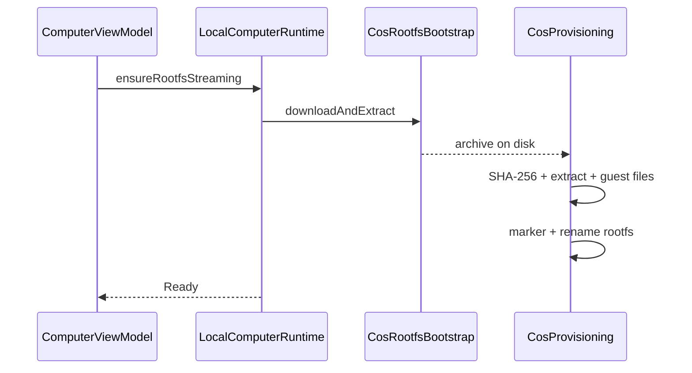

# 04 — Installing the phone's Linux filesystem

We open Computer, tap install, watch progress lines, and eventually get a Ready Alpine root we can shell into.

COS here means the on-device Computer: a rootless Alpine filesystem reached through proot, not a separate Termux install. Pinned to `eb46dfb`. This chapter ends when a verified extraction becomes the visible rootfs.

## 1. Ensure is the gate

[ComputerViewModel.ensureRootfs](https://github.com/xdutsuay/chidori-nagasa/blob/eb46dfb/app/src/main/java/com/druk/lmplayground/computer/ComputerViewModel.kt#L126) launches work on the ViewModel scope and streams progress into the terminal panel. The runtime path is [LocalComputerRuntime.ensureRootfsInternal](https://github.com/xdutsuay/chidori-nagasa/blob/eb46dfb/app/src/main/java/com/druk/lmplayground/computer/LocalComputerRuntime.kt#L137): Computer must be enabled, battery/thermal gates must pass, ABI must be supported, and an incompatible version marker triggers wipe-and-reprovision rather than migrate.

```kotlin
if (marker != null && CosProvisioning.needsReprovision(marker, CosConstants.ALPINE_VERSION, arch)) {
    // … deleting and re-provisioning …
    CosProvisioning.wipe(rootfsDir, cacheDir)
}
```

## 2. Download, checksum, extract, rename

[CosRootfsBootstrap.downloadAndExtract](https://github.com/xdutsuay/chidori-nagasa/blob/eb46dfb/app/src/main/java/com/druk/lmplayground/computer/CosRootfsBootstrap.kt#L45) fetches over HTTPS with resume into a `.part` file, then hands off to provisioning. [CosProvisioning.installVerified](https://github.com/xdutsuay/chidori-nagasa/blob/eb46dfb/app/src/main/java/com/druk/lmplayground/computer/CosProvisioning.kt#L115) checks SHA-256, extracts into a partial tree, writes guest files including DNS via [writeGuestFiles](https://github.com/xdutsuay/chidori-nagasa/blob/eb46dfb/app/src/main/java/com/druk/lmplayground/computer/CosProvisioning.kt#L93), writes the marker, and renames into place as the live rootfs.



Active-network DNS replaces defaults before execution later; install seeds resolv.conf up front. Success deletes the archive. Checksum or extract failure deletes archive/partial/rootfs as appropriate. Interrupted downloads can retain `.part` for resume.

**We decided:** pinned, checksummed Alpine; rootless; no separate Termux ([COS.md](https://github.com/xdutsuay/chidori-nagasa/blob/eb46dfb/docs/COS.md#L3), [provisioning section](https://github.com/xdutsuay/chidori-nagasa/blob/eb46dfb/docs/COS.md#L58)). **We think:** simpler onboarding costs tracing overhead; proot is not VM isolation. Destructive version upgrades need to be taught explicitly because they wipe the guest tree.

## Data lifecycle

| What | Created by | Deleted / retained |
|------|------------|--------------------|
| `files/cos/cache/*.part` | download | success/failure cleanup; transfer failure may retain |
| archive | download | success deletes; mismatch deletes |
| `files/cos/rootfs`, `.partial` | installVerified | `deleteRootfsKeepPrefs` / wipe |
| marker, resolv.conf | writeGuestFiles / install | rootfs deletion |
| preferences outside rootfs | Computer prefs | survive reinstall |

## Tradeoffs

Checksum-before-extract rejects a corrupt archive before it becomes a broken rootfs. Resume keeps partial network progress. The cost is more host-side state (`.part`, `.partial`) that must be understood during failure triage.

## Known gaps

- Agent `cos_exec` can call `ensureRootfs` automatically when the rootfs is missing ([CosAgentBridge](https://github.com/xdutsuay/chidori-nagasa/blob/eb46dfb/app/src/main/java/com/druk/lmplayground/computer/CosAgentBridge.kt#L37)), even though user-facing copy directs people to the Computer screen setup. Confirmed in source.
- Reinstall is not gated on desktop idleness ([07](07-restart-deletion-cleanup.md)).

## Try it

Corrupt an injected test archive (tests do this). Predict whether extraction runs. Answer from the code: checksum fails first in `installVerified`; extraction should not proceed on a digest mismatch.
