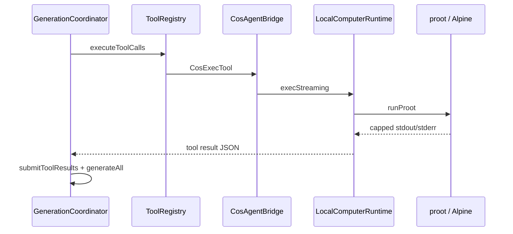

# 05 — A shell request, its result, and Stop

We ask the model to run a command in Computer, see a tool card, then sometimes press Stop while `sleep` is still running.

This chapter follows the local-chat tool path for `cos_exec` only. Inference/JNI internals and Room schema live in earlier chapters. Pinned to `eb46dfb`.

## 1. From chat Send into the tool registry

[ConversationViewModel.addMessage](https://github.com/xdutsuay/chidori-nagasa/blob/eb46dfb/app/src/main/java/com/druk/lmplayground/conversation/ConversationViewModel.kt#L739) still starts the turn. [GenerationCoordinator.runTurn](https://github.com/xdutsuay/chidori-nagasa/blob/eb46dfb/app/src/main/java/com/druk/lmplayground/conversation/GenerationCoordinator.kt#L96) refreshes tool enablement and may attach a COS prompt note without rewriting the stored user text. When the model requests tools, [ToolRegistry.executeToolCalls](https://github.com/xdutsuay/chidori-nagasa/blob/eb46dfb/app/src/main/java/com/druk/lmplayground/tools/ToolRegistry.kt#L78) dispatches to [CosExecTool.execute](https://github.com/xdutsuay/chidori-nagasa/blob/eb46dfb/app/src/main/java/com/druk/lmplayground/tools/CosExecTool.kt#L48).

[CosAgentBridge.exec](https://github.com/xdutsuay/chidori-nagasa/blob/eb46dfb/app/src/main/java/com/druk/lmplayground/computer/CosAgentBridge.kt#L28) builds a **new** [LocalComputerRuntime](https://github.com/xdutsuay/chidori-nagasa/blob/eb46dfb/app/src/main/java/com/druk/lmplayground/computer/CosAgentBridge.kt#L29) per call, checks Computer enabled / rootfs present, then runs `/bin/sh -c` under guest cwd `/root`:

```kotlin
return runtime.execStreaming(argv, AGENT_CWD, cancelReason = CHAT_STOP) { }
```

## 2. proot launch, collect, return

[LocalComputerRuntime.execStreaming](https://github.com/xdutsuay/chidori-nagasa/blob/eb46dfb/app/src/main/java/com/druk/lmplayground/computer/LocalComputerRuntime.kt#L197) refreshes guest DNS in [prepareGuest](https://github.com/xdutsuay/chidori-nagasa/blob/eb46dfb/app/src/main/java/com/druk/lmplayground/computer/LocalComputerRuntime.kt#L261), builds argv/env via [ProotCommand](https://github.com/xdutsuay/chidori-nagasa/blob/eb46dfb/app/src/main/java/com/druk/lmplayground/computer/ProotCommand.kt#L84), and [runProot](https://github.com/xdutsuay/chidori-nagasa/blob/eb46dfb/app/src/main/java/com/druk/lmplayground/computer/LocalComputerRuntime.kt#L276) drains stdout/stderr with a size cap. Chat does **not** line-stream shell output into the bubble; the collected result returns when the process ends, then the coordinator resumes assistant generation ([GenerationCoordinator](https://github.com/xdutsuay/chidori-nagasa/blob/eb46dfb/app/src/main/java/com/druk/lmplayground/conversation/GenerationCoordinator.kt#L349)). The Computer screen terminal callbacks are a different UI path.

Seccomp can fail on some devices; exec may retry with `PROOT_NO_SECCOMP=1` when the preference/fallback rules say so. Fake `.so` packaging of native helpers under `nativeLibraryDir` is how binaries ship ([COS.md](https://github.com/xdutsuay/chidori-nagasa/blob/eb46dfb/docs/COS.md#L25)).



## 3. Stop kills the process tree, not guest files

Chat Stop cancels the generation job. [ToolCallRunner.run](https://github.com/xdutsuay/chidori-nagasa/blob/eb46dfb/app/src/main/java/com/druk/lmplayground/conversation/ToolCallRunner.kt#L28) repeatedly calls `cancelInFlight` until the tool work joins. CosExec cancels its coroutine; [ProotTerminator.terminate](https://github.com/xdutsuay/chidori-nagasa/blob/eb46dfb/app/src/main/java/com/druk/lmplayground/computer/ProotTerminator.kt#L71) uses SIGQUIT, a grace period, then force-kill/backstop — not SIGKILL first ([COS.md](https://github.com/xdutsuay/chidori-nagasa/blob/eb46dfb/docs/COS.md#L111)). [StoppedToolRound.record](https://github.com/xdutsuay/chidori-nagasa/blob/eb46dfb/app/src/main/java/com/druk/lmplayground/conversation/StoppedToolRound.kt#L73) closes unanswered tool rounds so the next model turn does not inherit a hanging request.

Timeout uses exit 124. COS cancellation surfaces as exit 130 / `cancelled:true` — an app convention, not a guaranteed guest exit status. Files the command already wrote remain.

**We decided:** nativeLibraryDir packaging; SIGQUIT→grace→force ([COS.md](https://github.com/xdutsuay/chidori-nagasa/blob/eb46dfb/docs/COS.md#L111)). **We think:** per-call chat runtimes are not the Computer screen runtime; turning Computer off stops the screen runtime and desktop bridge, but does not by itself cancel an in-flight chat `cos_*` coroutine ([ComputerViewModel.setEnabled](https://github.com/xdutsuay/chidori-nagasa/blob/eb46dfb/app/src/main/java/com/druk/lmplayground/computer/ComputerViewModel.kt#L83) vs [CosAgentBridge](https://github.com/xdutsuay/chidori-nagasa/blob/eb46dfb/app/src/main/java/com/druk/lmplayground/computer/CosAgentBridge.kt#L29)).

## Data lifecycle

| What | Created | Cleanup / ownership |
|------|---------|---------------------|
| Per-call LocalComputerRuntime | CosAgentBridge.exec | ends with the call; not the Computer VM singleton |
| proot Process + PIDs | runProot | ProotTerminator on cancel; wait on success |
| capped stdout/stderr buffers | drain | discarded after tool JSON built |
| tool result JSON / Stopped state | ToolCallRunner / StoppedToolRound | persisted with assistant row |
| guest files written by the command | shell | survive Stop and chat delete |

Who owns cancellation: the chat generation Job → ToolCallRunner → CosExecTool.cancelInFlight → coroutine cancel → ProotTerminator.

## Tradeoffs

Collecting output (not streaming lines) keeps Binder/UI simpler and matches “tool result then continue generating.” The cost is a quiet card until the command finishes. Soft-then-hard kill prefers flushing over instant SIGKILL.

## Known gaps

- **Computer-off does not directly stop chat `cos_*` commands already running.** Confirmed: `setEnabled(false)` stops the Computer runtime and desktop; chat tools create separate runtimes and cancel only via chat Stop / ToolCallRunner.
- **Chat command output is collected, not line-streamed.** Confirmed by `execStreaming` + empty `onLine` in CosAgentBridge and coordinator resume-after-tools.
- Missing binaries → 127; unknown proot PID loses the full cleanup sweep (terminator needs a live handle).

## Try it

With Computer on and rootfs ready, ask for `sleep 90`, press Stop, then reopen the saved tool card. Trace cancellation to ProotTerminator and note whether exit/cancelled fields match the Stopped round codec. Predict that a file created before Stop still exists under rootfs.
