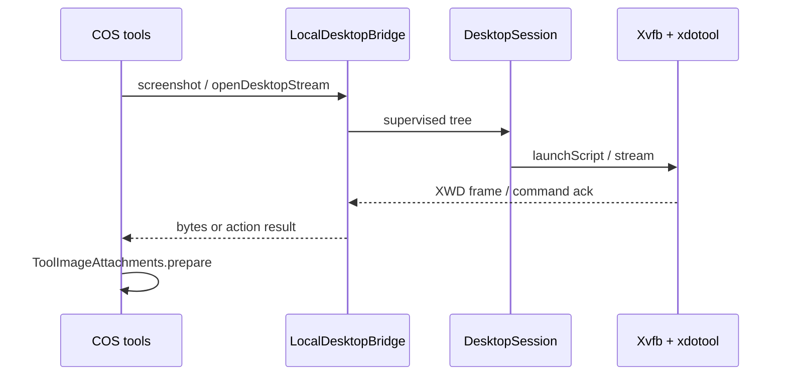

# 06 — CINDI sees and operates the desktop

We install the COS desktop packages, start the virtual display, ask for a screenshot or a click, and get image metadata or an action result back in chat.

CINDI here means the chat tools that drive the on-device desktop: framebuffer capture and xdotool input, not a VNC client. Pinned to `eb46dfb`.

## 1. Install and start one supervised tree

[LocalDesktopBridge.install](https://github.com/xdutsuay/chidori-nagasa/blob/eb46dfb/app/src/main/java/com/druk/lmplayground/computer/desktop/LocalDesktopBridge.kt#L98) installs the package set under the Alpine rootfs and writes an install marker. Exact package pins are verified after apk; index hashes are logged, not enforced the way the base Alpine archive digest is.

[LocalDesktopBridge.start](https://github.com/xdutsuay/chidori-nagasa/blob/eb46dfb/app/src/main/java/com/druk/lmplayground/computer/desktop/LocalDesktopBridge.kt#L168) → [DesktopSession.start](https://github.com/xdutsuay/chidori-nagasa/blob/eb46dfb/app/src/main/java/com/druk/lmplayground/computer/desktop/DesktopSession.kt#L64) launches [DesktopCommand.launchScript](https://github.com/xdutsuay/chidori-nagasa/blob/eb46dfb/app/src/main/java/com/druk/lmplayground/computer/desktop/DesktopCommand.kt#L90) through supervised proot. [xvfbArgv](https://github.com/xdutsuay/chidori-nagasa/blob/eb46dfb/app/src/main/java/com/druk/lmplayground/computer/desktop/DesktopCommand.kt#L70) disables TCP and abstract-local X listeners — a private filesystem socket, not a “localhost VNC server.”

```kotlin
// DesktopCommand.xvfbArgv — listen on unix socket only
```

DesktopSession remembers proot seccomp preference and may retry without seccomp. The input stream path is different: [openDesktopStream](https://github.com/xdutsuay/chidori-nagasa/blob/eb46dfb/app/src/main/java/com/druk/lmplayground/computer/desktop/LocalDesktopBridge.kt#L285) hardcodes `noSeccomp = false` for that launch.

## 2. Screenshot and GUI tools

[CosScreenshotTool.execute](https://github.com/xdutsuay/chidori-nagasa/blob/eb46dfb/app/src/main/java/com/druk/lmplayground/tools/CosScreenshotTool.kt#L45) asks the bridge for a frame ([screenshot](https://github.com/xdutsuay/chidori-nagasa/blob/eb46dfb/app/src/main/java/com/druk/lmplayground/computer/desktop/LocalDesktopBridge.kt#L276)), then [ToolImageAttachments.prepare](https://github.com/xdutsuay/chidori-nagasa/blob/eb46dfb/app/src/main/java/com/druk/lmplayground/tools/ToolImageAttachments.kt#L59) attaches at most one image for the coordinator to submit. A non-vision model still gets metadata and an explicit “not shown” path — the tool must not invent sight.

[CosGuiTool.execute](https://github.com/xdutsuay/chidori-nagasa/blob/eb46dfb/app/src/main/java/com/druk/lmplayground/tools/CosGuiTool.kt#L57) drives input through [XdotoolSession.run](https://github.com/xdutsuay/chidori-nagasa/blob/eb46dfb/app/src/main/java/com/druk/lmplayground/computer/desktop/input/XdotoolSession.kt#L174). Touch gestures and model commands share a queue; script-mode success is not visual proof that the UI changed.



**We decided:** framebuffer + xdotool, no VNC in v1 ([plan](https://github.com/xdutsuay/chidori-nagasa/blob/eb46dfb/docs/plans/CP2-CP5-MASTER-PLAN.md#L14)); disable TCP/abstract X listeners ([DesktopCommand](https://github.com/xdutsuay/chidori-nagasa/blob/eb46dfb/app/src/main/java/com/druk/lmplayground/computer/desktop/DesktopCommand.kt#L70)). **We think:** fewer transport dependencies versus decoding cost and tearing. The app [MIT LICENSE](https://github.com/xdutsuay/chidori-nagasa/blob/eb46dfb/LICENSE#L1) coexists with [GPL proot / LGPL talloc NOTICE](https://github.com/xdutsuay/chidori-nagasa/blob/eb46dfb/app/src/main/assets/licenses/NOTICE#L20); no x11vnc launch is implemented here.

## Data lifecycle

| What | Created | Cleanup |
|------|---------|---------|
| desktop packages + install marker | install | rootfs deletion |
| Xauthority cookie, XWD fb, session.log | launch | next launch replaces/truncates; Stop retains |
| `/tmp/.X*` locks | Xvfb | `DesktopStaleCleanup.removeXLocks` / guest script |
| `cache/cos-desktop/last.png` | panel screenshot | overwritten; not cleared by chat delete |
| tool image bytes | ToolImageAttachments | consume/evict (capacity two); not durable Room blobs |

Input cancellation closes its stream, not the whole desktop. Stop is not image/log erasure.

## Tradeoffs

Private unix sockets avoid exposing an X server on TCP. Hardcoding `noSeccomp=false` on the stream launch diverges from the remembered exec/session fallback — simpler stream code, less shared policy.

## Known gaps

- **Desktop launch stream hardcodes `noSeccomp=false`.** Confirmed at [LocalDesktopBridge.kt:293](https://github.com/xdutsuay/chidori-nagasa/blob/eb46dfb/app/src/main/java/com/druk/lmplayground/computer/desktop/LocalDesktopBridge.kt#L293); DesktopSession itself uses the remembered preference.
- Screenshot with a non-vision model yields metadata + “not shown,” not hallucinated pixels — verify in CosScreenshotTool when teaching.

## Try it

Start desktop, run a screenshot tool with a text-only model selected. Predict the tool card contents before looking: metadata and an explicit not-shown note, no invented description of pixels.
