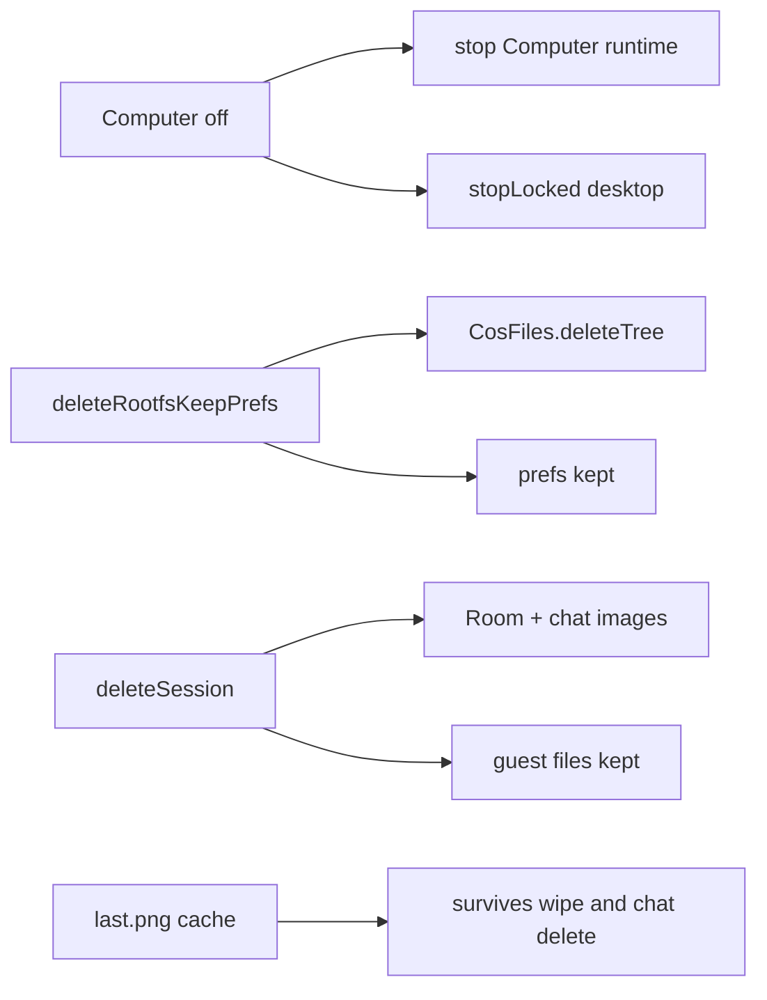

# 07 — Restart, deletion, and cleanup ownership

We toggle Computer off, wipe the rootfs, delete a chat, or kill the app — and four different leftovers appear unless we know which owner ran.

These are different operations, not one cascading teardown. Pinned to `eb46dfb`.

## 1. Computer off is not chat delete

[ComputerViewModel.setEnabled(false)](https://github.com/xdutsuay/chidori-nagasa/blob/eb46dfb/app/src/main/java/com/druk/lmplayground/computer/ComputerViewModel.kt#L83) stops the Computer runtime, asks [LocalDesktopBridge.stopAsync](https://github.com/xdutsuay/chidori-nagasa/blob/eb46dfb/app/src/main/java/com/druk/lmplayground/computer/ComputerViewModel.kt#L88), and stops the keep-alive service. [LocalDesktopBridge.stopLocked](https://github.com/xdutsuay/chidori-nagasa/blob/eb46dfb/app/src/main/java/com/druk/lmplayground/computer/desktop/LocalDesktopBridge.kt#L221) tears down the supervised desktop tree. Restart later retains installs and preferences and saved tool rows; it does not resurrect live bridge handles.

Chat Stop is still the cancellation owner for in-flight `cos_*` tool coroutines ([05](05-shell-request-and-stop.md)).

## 2. Rootfs wipe versus chat delete

[LocalComputerRuntime.deleteRootfsKeepPrefs](https://github.com/xdutsuay/chidori-nagasa/blob/eb46dfb/app/src/main/java/com/druk/lmplayground/computer/LocalComputerRuntime.kt#L100) deletes the rootfs and partial trees via [CosFiles.deleteTree](https://github.com/xdutsuay/chidori-nagasa/blob/eb46dfb/app/src/main/java/com/druk/lmplayground/computer/CosFiles.kt#L23) (symlink-safe). [CosProvisioning.wipe](https://github.com/xdutsuay/chidori-nagasa/blob/eb46dfb/app/src/main/java/com/druk/lmplayground/computer/CosProvisioning.kt#L75) also clears archives during reprovision. [ComputerPruner.planPrune](https://github.com/xdutsuay/chidori-nagasa/blob/eb46dfb/app/src/main/java/com/druk/lmplayground/computer/ComputerPruner.kt#L14) protects the live rootfs when pruning caches.

[ChatSessionStore.deleteSession](https://github.com/xdutsuay/chidori-nagasa/blob/eb46dfb/app/src/main/java/com/druk/lmplayground/conversation/ChatSessionStore.kt#L233) removes message rows and attachment images. Guest files created by earlier commands remain. Tool cards and Stopped state persist across chat reopen through [ToolCallInfoCodec](https://github.com/xdutsuay/chidori-nagasa/blob/eb46dfb/app/src/main/java/com/druk/lmplayground/conversation/ToolCallInfoCodec.kt#L18) — older COS docs that said tool rows vanish are stale.

## 3. Stale X locks and host-side cleanup

[DesktopStaleCleanup.removeXLocks](https://github.com/xdutsuay/chidori-nagasa/blob/eb46dfb/app/src/main/java/com/druk/lmplayground/computer/desktop/DesktopStaleCleanup.kt#L13) deletes lock and socket files under the host-visible rootfs `tmp` before the next start. It does not check whether a guest process still owns them — it is a backstop after force-kill. The panel’s [screenshot](https://github.com/xdutsuay/chidori-nagasa/blob/eb46dfb/app/src/main/java/com/druk/lmplayground/computer/desktop/DesktopPanelViewModel.kt#L76) writes `cache/cos-desktop/last.png`, which rootfs wipe and chat deletion do not clear.

**We decided:** symlink-safe deletion ([CosFiles.deleteTree](https://github.com/xdutsuay/chidori-nagasa/blob/eb46dfb/app/src/main/java/com/druk/lmplayground/computer/CosFiles.kt#L23)). **We think:** retention and cancellation need named resource owners beyond GC; “Computer off” is not a global stop-all.

## Data lifecycle matrix

| What / where | Created by | Deleted / retained |
|---|---|---|
| `files/cos/cache/*.part` | downloadAndExtract | installVerified success/failure; transfer failure retains |
| `files/cos/rootfs`, `.partial` | installVerified | deleteRootfsKeepPrefs; wipe also removes archives |
| `rootfs/var/lib/cos-desktop/{installed,Xauthority,fb,session.log}` | install/launchScript | rootfs deletion; next launch replaces cookie/frame, truncates log; Stop retains |
| `rootfs/tmp/.X*` | Xvfb | removeXLocks; other guest temp may persist |
| `cache/proot-tmp`, `files/cos/l2s`, COS preferences/history | runtime/preferences | rootfs-only deletion does not clear |
| `cache/cos-desktop/last.png` | DesktopPanelViewModel.screenshot | overwritten; rootfs wipe/chat deletion do not clear |
| tool image bytes | ToolImageAttachments | consume/evict; no durable tool image |
| Room tool rows/stopped/exit | persistMessage + codec | deleteSession; survives saved-chat reopen |

## Tradeoffs

Separate owners avoid a brittle mega-destructor, but make “did I delete everything?” a checklist question. Host-side X lock removal unblocks restart after crashes; it can also remove locks while a live owner still exists if called at the wrong time.

## Known gaps

- **Rootfs reinstall allowed while desktop running.** `reinstallRootfsStreaming` deletes rootfs without requiring desktop Stop first ([LocalComputerRuntime](https://github.com/xdutsuay/chidori-nagasa/blob/eb46dfb/app/src/main/java/com/druk/lmplayground/computer/LocalComputerRuntime.kt#L105)).
- **X lock cleanup removes locks before owner liveness checks.** Confirmed in [DesktopStaleCleanup](https://github.com/xdutsuay/chidori-nagasa/blob/eb46dfb/app/src/main/java/com/druk/lmplayground/computer/desktop/DesktopStaleCleanup.kt#L13).
- **Rootfs wipe leaves screenshot cache and other app data.** Confirmed: `last.png`, proot-tmp, prefs outside rootfs.
- **Tool rows + Stopped state survive restart;** older COS docs contradict this. Codec persists them ([ToolCallInfoCodec](https://github.com/xdutsuay/chidori-nagasa/blob/eb46dfb/app/src/main/java/com/druk/lmplayground/conversation/ToolCallInfoCodec.kt#L18)).

## Try it

In a disposable chat, run a command that writes `/root/hello.txt`, then delete the chat. Predict: message rows/images gone; guest file remains until rootfs wipe. Then toggle Computer off during an unrelated idle state and list which processes/handles should be gone versus which Room rows remain.
