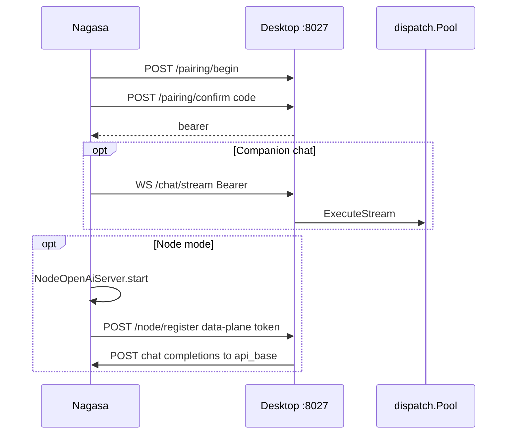

# 08 — Pairing and node mode (phone side)

We discover a desktop on Wi‑Fi, type a six-digit code, then either watch desktop runs from the phone or offer the phone as an inference node.

This chapter is the Android half. Desktop companion details live in [`desktop/06-phone-reaches-desktop.md`](desktop/06-phone-reaches-desktop.md). Never paste real tokens, codes, or addresses into notes. Pinned to Nagasa `eb46dfb` (desktop references use `ae845fa`).

## 1. Pairing: code in, bearer out

[PairingManagerImpl.beginPairing](https://github.com/xdutsuay/chidori-nagasa/blob/eb46dfb/app/src/main/java/com/druk/lmplayground/coordinator/pairing/PairingManager.kt#L122) upserts a local “pairing in progress” row, then calls [CoordinatorApi.beginPairing](https://github.com/xdutsuay/chidori-nagasa/blob/eb46dfb/app/src/main/java/com/druk/lmplayground/coordinator/transport/CoordinatorApi.kt#L281). Confirm uses [confirmPairing](https://github.com/xdutsuay/chidori-nagasa/blob/eb46dfb/app/src/main/java/com/druk/lmplayground/coordinator/transport/CoordinatorApi.kt#L302) and stores the returned bearer with the instance in [PairedInstance](https://github.com/xdutsuay/chidori-nagasa/blob/eb46dfb/app/src/main/java/com/druk/lmplayground/coordinator/pairing/data/PairedInstanceEntity.kt#L23) via the pairing DB.

Desktop mirrors: [ChidoriPairingBegin](https://github.com/xdutsuay/lclreason/blob/ae845fa/internal/api/chidori_handlers.go#L73) generates a short-lived one-use code; confirm returns `instance_id` + `auth_token`. Companion traffic uses a listener distinct from the IDE API (default port 8027 per [WIRE_CONTRACT.md](https://github.com/xdutsuay/chidori-nagasa/blob/eb46dfb/WIRE_CONTRACT.md#L3)).

[PairingManagerImpl.unpair](https://github.com/xdutsuay/chidori-nagasa/blob/eb46dfb/app/src/main/java/com/druk/lmplayground/coordinator/pairing/PairingManager.kt#L165) tries remote revoke, then deletes the local record even if the network call fails. Desktop [RevokePairing](https://github.com/xdutsuay/lclreason/blob/ae845fa/internal/registry/chidori_companion.go#L265) clears the in-memory bearer.

A source comment on PairingManager still calls the wire contract an unreconciled draft ([line 107](https://github.com/xdutsuay/chidori-nagasa/blob/eb46dfb/app/src/main/java/com/druk/lmplayground/coordinator/pairing/PairingManager.kt#L107)). [WIRE_CONTRACT.md](https://github.com/xdutsuay/chidori-nagasa/blob/eb46dfb/WIRE_CONTRACT.md#L3) marks the contract **Active**, and desktop registers matching routes — treat the comment as stale.

## 2. Chat WebSocket versus node inference

Remote chat uses [observeRemoteChat](https://github.com/xdutsuay/chidori-nagasa/blob/eb46dfb/app/src/main/java/com/druk/lmplayground/coordinator/transport/CoordinatorApi.kt#L625). On collector exit the socket is closed and removed ([666](https://github.com/xdutsuay/chidori-nagasa/blob/eb46dfb/app/src/main/java/com/druk/lmplayground/coordinator/transport/CoordinatorApi.kt#L666)); failure callbacks signal DISCONNECTED and close — there is no transport-owned reconnect loop ([654](https://github.com/xdutsuay/chidori-nagasa/blob/eb46dfb/app/src/main/java/com/druk/lmplayground/coordinator/transport/CoordinatorApi.kt#L654)).

Node mode reverses direction. [DefaultNodeRegistrationCapability.registerAsNode](https://github.com/xdutsuay/chidori-nagasa/blob/eb46dfb/app/src/main/java/com/druk/lmplayground/coordinator/node/DefaultNodeRegistrationCapability.kt#L45) starts [NodeOpenAiServer](https://github.com/xdutsuay/chidori-nagasa/blob/eb46dfb/app/src/main/java/com/druk/lmplayground/coordinator/node/NodeOpenAiServer.kt#L44), registers via [CoordinatorApi.registerAsNode](https://github.com/xdutsuay/chidori-nagasa/blob/eb46dfb/app/src/main/java/com/druk/lmplayground/coordinator/transport/CoordinatorApi.kt#L687) with endpoint/model plus a fresh data-plane token and nonce, then heartbeats ([713](https://github.com/xdutsuay/chidori-nagasa/blob/eb46dfb/app/src/main/java/com/druk/lmplayground/coordinator/transport/CoordinatorApi.kt#L713)) about every 15s. Heartbeat failures are logged and the loop continues ([86](https://github.com/xdutsuay/chidori-nagasa/blob/eb46dfb/app/src/main/java/com/druk/lmplayground/coordinator/node/DefaultNodeRegistrationCapability.kt#L86)) — do not assume automatic UI recovery without checking resubscription.

Desktop calls the phone’s completion endpoint; the phone authorizes with the data-plane token ([NodeOpenAiServer.authorized](https://github.com/xdutsuay/chidori-nagasa/blob/eb46dfb/app/src/main/java/com/druk/lmplayground/coordinator/node/NodeOpenAiServer.kt#L318)) and runs inference through [NodeInferenceBridge](https://github.com/xdutsuay/chidori-nagasa/blob/eb46dfb/app/src/main/java/com/druk/lmplayground/coordinator/node/NodeInferenceBridge.kt#L23) / [ModelRuntime.nodeModeComplete](https://github.com/xdutsuay/chidori-nagasa/blob/eb46dfb/app/src/main/java/com/druk/lmplayground/inference/ModelRuntime.kt#L676).

Unregister: [unregisterAsNode](https://github.com/xdutsuay/chidori-nagasa/blob/eb46dfb/app/src/main/java/com/druk/lmplayground/coordinator/node/DefaultNodeRegistrationCapability.kt#L109) → [NodeService.tearDown](https://github.com/xdutsuay/chidori-nagasa/blob/eb46dfb/app/src/main/java/com/druk/lmplayground/coordinator/node/NodeService.kt#L124) cancels heartbeat and stops the host.

**We decided:** discovery/cleartext/pairing/versioning in [CHIDORI_PROTOCOL.md](https://github.com/xdutsuay/chidori-nagasa/blob/eb46dfb/CHIDORI_PROTOCOL.md#L48); two roles ([§104](https://github.com/xdutsuay/chidori-nagasa/blob/eb46dfb/CHIDORI_PROTOCOL.md#L104)); active endpoints in [WIRE_CONTRACT.md](https://github.com/xdutsuay/chidori-nagasa/blob/eb46dfb/WIRE_CONTRACT.md#L3). **We think:** LAN is a trust boundary, not encryption; companion bearer and phone data-plane token have different directions and owners; rotating the desktop bearer can invalidate an earlier pairing.

## Data lifecycle

| What | Created | Cleanup |
|------|---------|---------|
| Discovered endpoint | mDNS / manual host:port | disappears when browse stops |
| Pairing code | desktop BeginPairing | one-use + TTL |
| Companion bearer | confirm | revoke / desktop restart (in-memory on desktop) |
| Phone pairing DB row | confirm | unpair deletes local even if remote fails |
| Node server + data-plane token | registerAsNode | unregister / tearDown |
| Chat WebSocket | observeRemoteChat | awaitClose closes socket |

## Tradeoffs

Cleartext on LAN keeps pairing simple on home Wi‑Fi and matches the v1 contract. The cost is that network presence equals trust once paired. Separate companion and IDE ports keep phone traffic off the main IDE mux.

## Known gaps

- Stale PairingManager “unreconciled draft” comment versus active WIRE_CONTRACT — confirmed mismatch in docs vs comment.
- Heartbeat failures continue the loop without proving UI re-registration after desktop restart — needs follow-up evidence before claiming automatic recovery.
- Desktop companion auth token is in-memory; desktop restart requires re-pair from the phone’s point of view unless a persistence path is added later.

## Try it

Draw arrows for companion requests versus node inference requests. Label which bearer each side checks. Predict what the phone should do after a desktop restart without writing down any real token.
