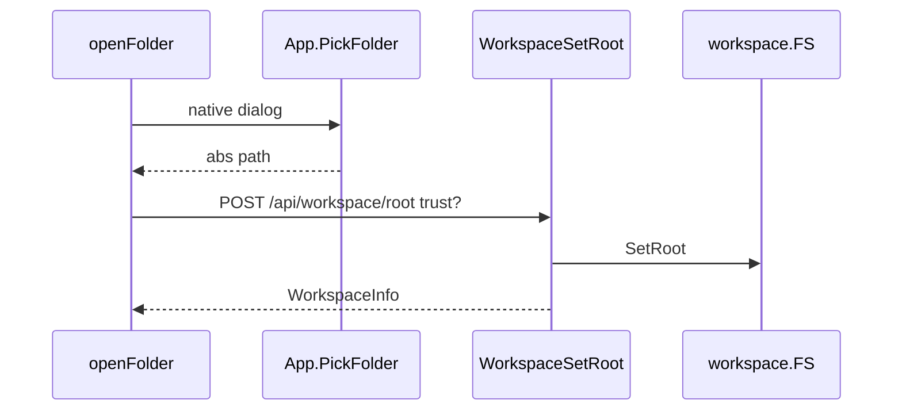

# 01 — Opening Chidori and trusting a workspace

We launch the packaged app, wait until the UI feels alive, then Open Folder and trust a directory so Agent tools can touch files.

Pinned to `ae845fa`. Function names below were checked against the tree at that commit, not taken on faith from older guides.

## 1. Boot: Wails app supervises the coordinator

[`main`](https://github.com/xdutsuay/lclreason/blob/ae845fa/cmd/lclreason-app/main.go#L35) constructs the Wails app. [`NewApp`](https://github.com/xdutsuay/lclreason/blob/ae845fa/cmd/lclreason-app/main.go#L155) sets port and config paths. [`App.startup`](https://github.com/xdutsuay/lclreason/blob/ae845fa/cmd/lclreason-app/main.go#L180) loads config and starts [`superviseCoordinator`](https://github.com/xdutsuay/lclreason/blob/ae845fa/cmd/lclreason-app/main.go#L266), which restarts on failure with backoff. Each attempt calls [`runCoordinatorOnce`](https://github.com/xdutsuay/lclreason/blob/ae845fa/cmd/lclreason-app/main.go#L321) → [`coordinator.Run`](https://github.com/xdutsuay/lclreason/blob/ae845fa/internal/coordinator/run.go#L31).

`Run` opens the store, builds registry and [`dispatch.Pool`](https://github.com/xdutsuay/lclreason/blob/ae845fa/internal/dispatch/pool.go#L37), registers tools against a long-lived [`workspace.FS`](https://github.com/xdutsuay/lclreason/blob/ae845fa/internal/workspace/fs.go#L48) pointer (even if root is empty), then starts [`Server.Start`](https://github.com/xdutsuay/lclreason/blob/ae845fa/internal/api/server.go#L637). Shutdown on context cancel uses [`Server.Shutdown`](https://github.com/xdutsuay/lclreason/blob/ae845fa/internal/api/server.go#L840) with a timeout; the store closes in `defer`.

```go
func Run(ctx context.Context, cfg *config.Config) error {
	st, err := store.Open(cfg.DB)
	// …
	go func() { _ = srv.Start() }()
```

**We decided:** the desktop process supervises the coordinator so a coordinator failure need not kill the whole Wails UI without a restart attempt (see `superviseCoordinator` comments in `main.go`). **We think:** “healthy” means `/health` answers, not “every optional backend is up.”

## 2. Open Folder is a trust boundary

[`openFolder`](https://github.com/xdutsuay/lclreason/blob/ae845fa/internal/appui/public/js/05-inference-keys.js#L1366) requires Wails [`App.PickFolder`](https://github.com/xdutsuay/lclreason/blob/ae845fa/cmd/lclreason-app/main.go#L479). [`requestOpenFolder`](https://github.com/xdutsuay/lclreason/blob/ae845fa/internal/appui/public/js/05-inference-keys.js#L1405) runs the trust UX, then `setWorkspaceRoot` POSTs to [`Handlers.WorkspaceSetRoot`](https://github.com/xdutsuay/lclreason/blob/ae845fa/internal/api/workspace_handlers.go#L72), which calls [`workspace.FS.SetRoot`](https://github.com/xdutsuay/lclreason/blob/ae845fa/internal/workspace/fs.go#L62) and persists root/trust into config.



Agent tools registered at boot keep the same `*FS` pointer; SetRoot updates them in place. Without a root, agent handlers return workspace-not-configured.

## Data lifecycle

| What | Created | Cleanup / owner |
|------|---------|-----------------|
| config + secrets paths | startup | process exit; files remain on disk |
| store DB | `store.Open` | `st.Close` on Run return |
| registry / pool | Run | GC after shutdown; no durable nodes except what registry persists elsewhere |
| HTTP listeners | Server.Start | Server.Shutdown |
| mDNS advertisement | startMDNS | stopped with companion/server shutdown |
| workspace root + trust lists | WorkspaceSetRoot / Trust | config.yaml; Close Folder clears root but keeps recent/trusted |

Cancellation of boot is the app context; superviseCoordinator owns restart.

## Tradeoffs

**We decided:** trust is an explicit user action persisted in config (workspace handler comments; ADR-0005 referenced from flow docs). Sandbox path rules live in `FS.Resolve`. **We think:** registering workspace tools before a folder is chosen avoids rewiring on Open Folder, at the cost of every tool call needing an Enabled check.

## Known gaps

- Packaged mDNS entitlements differ from bare-binary success (CLAUDE.md / companion chapter). Dev “advertising” logs are not proof the `.app` is browsable.
- An Agent tool before Open Folder fails closed with `no_workspace` — confirmed by `AgentRunWithBody` workspace gate.

## Try it

Predict what happens when an Agent tool runs before a folder is selected. Answer from code: `AgentRunWithBody` returns workspace not configured; tools that call `wsFS.Enabled()` likewise refuse. Then Open Folder without trusting and ask whether auto-apply writes are allowed (trust gate forces propose-only).
