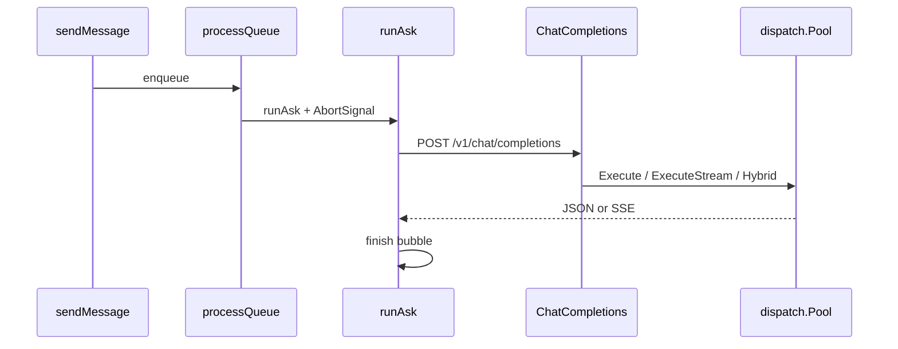

# 02 — Send an Ask message

We set mode to Ask, type a question, hit Send, and watch a bot bubble fill — live in the dev browser, or in one shot in the packaged app.

Ask does not run the agent tool loop. Pinned to `ae845fa`.

## 1. Queue, then one completion

[`sendMessage`](https://github.com/xdutsuay/lclreason/blob/ae845fa/internal/appui/public/js/08-debug-search-diff.js#L3026) paints the user bubble and enqueues. [`processQueue`](https://github.com/xdutsuay/lclreason/blob/ae845fa/internal/appui/public/js/08-debug-search-diff.js#L3123) sets `streaming`, creates an `AbortController`, shows Stop, and calls [`runAsk`](https://github.com/xdutsuay/lclreason/blob/ae845fa/internal/appui/public/js/08-debug-search-diff.js#L3295).

`runAsk` POSTs `/v1/chat/completions` to [`Handlers.ChatCompletions`](https://github.com/xdutsuay/lclreason/blob/ae845fa/internal/api/handlers.go#L285). The handler resolves routing with [`dispatch.ResolveProvider`](https://github.com/xdutsuay/lclreason/blob/ae845fa/internal/dispatch/routing.go#L25), then calls [`Pool.Execute`](https://github.com/xdutsuay/lclreason/blob/ae845fa/internal/dispatch/pool.go#L84), [`ExecuteStream`](https://github.com/xdutsuay/lclreason/blob/ae845fa/internal/dispatch/pool.go#L276), or [`ExecuteHybrid`](https://github.com/xdutsuay/lclreason/blob/ae845fa/internal/dispatch/pool.go#L170). Streaming uses [`streamChat`](https://github.com/xdutsuay/lclreason/blob/ae845fa/internal/api/handlers.go#L846).

[`isPackagedApp`](https://github.com/xdutsuay/lclreason/blob/ae845fa/internal/appui/public/js/05-inference-keys.js#L726) chooses `stream: false` in the packaged app and `stream: true` in the dev browser.

## 2. Draft and upgrade is UI orchestration

When draft mode is on and the prompt looks hard, Ask calls `runDraftAndUpgrade` in the same JS module (see comment near [line 3209](https://github.com/xdutsuay/lclreason/blob/ae845fa/internal/appui/public/js/08-debug-search-diff.js#L3209)): local draft fetch first, then upgrade with the user’s provider. Both hit normal `ChatCompletions`. **We decided:** that shape is [ADR-0008](https://github.com/xdutsuay/lclreason/blob/ae845fa/docs/adr/ADR-0008-draft-and-upgrade.md#L1) — reject token-level speculative decoding over chat APIs; adopt draft+upgrade UX.

Forced-local uses provider hint `"local"` / related aliases recognized by [`isLocalHint`](https://github.com/xdutsuay/lclreason/blob/ae845fa/internal/dispatch/pool.go#L353). If no healthy local node exists and no remote is configured, Pool returns no-backend.

## Data lifecycle

| What | Created | Cleanup |
|------|---------|---------|
| messageQueue / streaming flags | processQueue | finish / stopAgent clears |
| AbortController | processQueue | abort on Stop |
| request context + timeout | ChatCompletions | cancel on client abort / timeout |
| response text + usage | Pool result | painted into DOM; session persist is a separate writer (chapter 05) |
| draft bubble | runDraftAndUpgrade | replaced by upgrade or left as draft |

## Tradeoffs

**We decided:** Ask stays a completion path; tools belong to Agent. Packaged non-stream avoids WKWebView SSE limits (ADR-0017, referenced from flow docs). **We think:** draft mode doubles hard-prompt cost when on — the Settings toggle exists because that trade is the user’s.

## Known gaps

- Ask streaming has no server TTFT watchdog like Agent’s invoker path (noted in flow_for_author / hang map). Treat as a reliability difference, not a claim we re-timed.
- Historical AbortSignal wiring gaps for draft mode are called out in ADR-0008 / audits — re-check `runDraftAndUpgrade` signal threading before asserting Stop cancels drafts.

## Try it

Trace forced-local when no local node is healthy: set provider to local, detach backends, send Ask. Predict Pool error surfaces as a failed bubble, not a silent hang. Then enable draft mode with both local and remote available and mark when the session should contain only the final upgraded text (ADR-0008).
