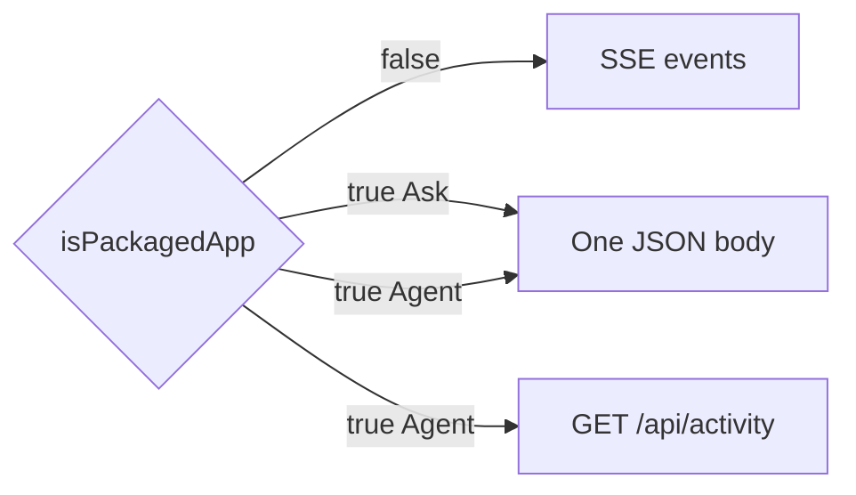

# 04 — Watch the reply, then press Stop

We watch tokens or tool cards arrive, then press Stop and expect the UI to unlock and in-flight work to notice cancel.

Pinned to `ae845fa`.

## 1. Two transports, one renderer

Dev browser Ask/Agent use SSE (`stream: true`). Packaged Ask uses one JSON body. Packaged Agent still updates via [`startPackagedAgentProgressPoll`](https://github.com/xdutsuay/lclreason/blob/ae845fa/internal/appui/public/js/05-inference-keys.js#L778) on `/api/activity` while waiting for the final JSON+trace. Gate: [`isPackagedApp`](https://github.com/xdutsuay/lclreason/blob/ae845fa/internal/appui/public/js/05-inference-keys.js#L726).

Activity events go through an in-memory bus (mutex ring buffer — not a blocking channel), so packaged poll does not deadlock on backpressure the way an unbounded channel might.

## 2. Stop cancels the request context

[`stopAgent`](https://github.com/xdutsuay/lclreason/blob/ae845fa/internal/appui/public/js/08-debug-search-diff.js#L2334) calls `agentAbort.abort()`. The browser closes the fetch; the handler’s `r.Context()` cancels; `Loop.run` / Pool HTTP clients see `ctx.Err()`. Tools that use `CommandContext` die with that context. Background jobs are separate: cancel goes through job handlers, not the foreground AbortController alone.

A short UI grace may force-clear `streaming` if a fetch ignores abort — a band-aid noted in audits, not a guarantee that every child process exited.

**We decided:** shared `RemoteRequestTimeout` ceiling for slow remotes; client Abort should win sooner. **We think:** request lifetime and durable job lifetime must stay distinct vocabulary or Stop will be misunderstood.

## Data lifecycle

| What | Created | Cleanup |
|------|---------|---------|
| SSE writer / stream buffers | streamChat / agent SSE | Done / connection close |
| activity ring entries | emit during run | overwritten in ring; not durable chat |
| AbortController / streaming flag | processQueue | stopAgent / finish |
| child processes from tools | shell_exec etc. | ctx cancel / process wait |
| packaged poll timer | startPackagedAgentProgressPoll | abort signal |

## Tradeoffs

Transport fork keeps packaged WKWebView working without SSE. Cost: two code paths that must stay event-compatible (ADR-0017). Activity bus avoids backpressure deadlock; it can also drop old events when the ring wraps.

## Known gaps

- Packaged Stop depending on fetch abort vs `/api/runs/{id}/cancel` for cases where WKWebView does not cancel `r.Context()` — handler comments mention KMA-6; verify on a real packaged build before asserting.
- Recheck any old “SSE hang / watchdog” notes against current `sse.go` and client watchdogs before citing them as current bugs.

## Try it

Start an Agent turn that runs a long `shell_exec`, press Stop, and check: UI `streaming` cleared, tool card shows cancellation/error, and the child process is gone (`ps`). Separately Stop during Ask SSE in the dev browser and confirm the next queue item can run.
