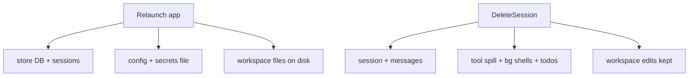

# 05 — Close, reopen, delete the conversation

We finish a chat, quit the app, come back, then delete the session from the sidebar — and we want an honest inventory of what remains.

Pinned to `ae845fa`. This chapter does not promise secure erase.

## 1. What “the conversation” actually is

Session metadata and messages are stored through the session service and HTTP handlers in [`ide_handlers.go`](https://github.com/xdutsuay/lclreason/blob/ae845fa/internal/api/ide_handlers.go#L14). Create/list/get/update write session rows. [`SaveSessionMessages`](https://github.com/xdutsuay/lclreason/blob/ae845fa/internal/api/ide_handlers.go#L120) replaces the message list for a session id. Ask/Agent also persist tasks/turns through the store during runs (see `persistAgentTask` in code_handlers).

Reopen loads [`GetSession`](https://github.com/xdutsuay/lclreason/blob/ae845fa/internal/api/ide_handlers.go#L54) — session plus messages. UI buffers and in-memory activity rings do not survive process death; config, secrets file, workspace files, and the store DB do.

## 2. Delete is logical for the session, not the universe

[`DeleteSession`](https://github.com/xdutsuay/lclreason/blob/ae845fa/internal/api/ide_handlers.go#L99) deletes the session via `h.sessions.Delete`, then best-effort cleans spilled tool output, background shells for that session, todos, and session update logs:

```go
_ = tools.CleanupSessionToolOutput(id)
tools.DefaultBgShell.CleanupSession(id)
if h.todos != nil { h.todos.Delete(id) }
```

Workspace edits applied earlier remain on disk. Secrets in the secrets file remain. Checkpoints/backups under the workspace, if created, are not the same as chat rows. Go GC will not close listeners or kill child processes — shutdown and explicit cancel own those.



**We decided:** session delete also drops associated todo/spill/bg-shell state (handler comments KMA-282/283/284). **We think:** “delete conversation” in the UI must be taught as “delete session records,” not “revert the repo.”

## Data lifecycle inventory

| Artifact | Survives restart? | Removed by DeleteSession? |
|----------|-------------------|---------------------------|
| Conversation messages | yes (store) | yes |
| Agent task/turn rows | yes (store) | not necessarily the same call — verify store cascades before assuming |
| Tool evidence in transcript | yes if saved in messages/trace | with messages |
| Activity ring / live SSE buffers | no | n/a |
| Applied workspace edits | yes | no |
| Settings / API keys | yes | no |
| Checkpoints / backups under workspace | yes if created | no |
| Companion pairing token (desktop memory) | no (in-memory) | n/a — re-pair |

Process shutdown: `coordinator.Run` cancel → `Server.Shutdown` → store Close. That is not DeleteSession.

## Tradeoffs

Keeping workspace mutations out of session delete avoids surprising git history loss. The cost is user expectation: deleting a chat will not undo Accept.

## Known gaps

- Exact cascade of agent task rows vs session id needs a store-schema read when auditing retention; this chapter only asserts what `DeleteSession` itself calls.
- Never promise secure erase: deleted SQLite rows and files may remain in free space / backups / Time Machine.

## Try it

Create a disposable session, Accept one trivial edit, restart the app, confirm the session and file edit remain, delete the session, then inspect: messages gone, edit still on disk, secrets file untouched.
