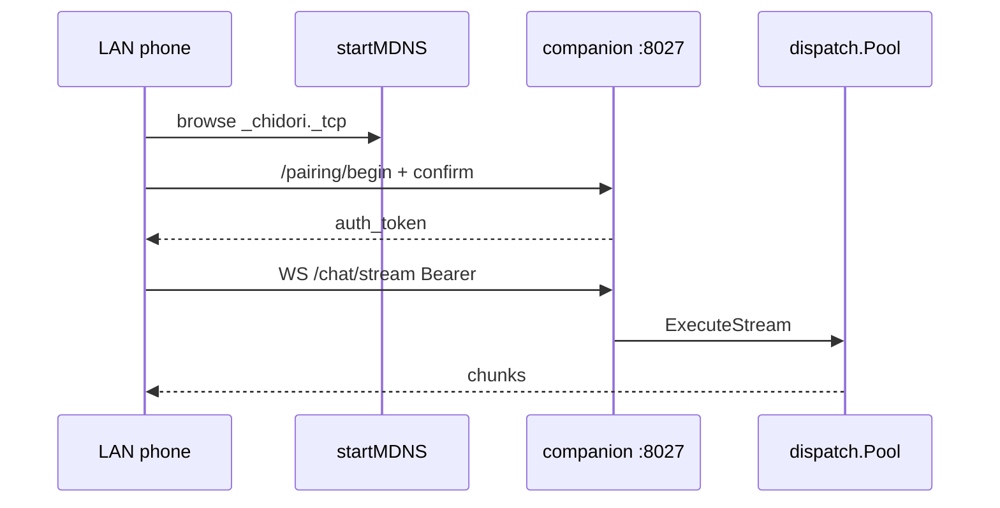

# 06 — The phone reaches the desktop

We open Settings → Companion, see a listening address on port 8027, pair a phone, and optionally serve chat over the companion WebSocket.

Phone-side pairing and node mode are documented in [Nagasa §08](../08-pairing-and-node-mode.md). This chapter is desktop-only. Pinned to `ae845fa`. Do not record real tokens or LAN addresses in notes.

## 1. Companion listener beside the IDE

[`coordinator.Run`](https://github.com/xdutsuay/lclreason/blob/ae845fa/internal/coordinator/run.go#L31) builds the API server. [`Server.Start`](https://github.com/xdutsuay/lclreason/blob/ae845fa/internal/api/server.go#L637) listens on the IDE port and starts the companion listener (default **8027**). [`startMDNS`](https://github.com/xdutsuay/lclreason/blob/ae845fa/internal/api/server.go#L883) advertises `_chidori._tcp` with TXT fields (`protocol_version`, `instance_id`, `display_name`, `pairing_required`). Routes register on a dedicated mux ([`companionMux`](https://github.com/xdutsuay/lclreason/blob/ae845fa/internal/api/server.go#L588)), including pairing begin/confirm and chat WebSocket.

If the companion port is busy, Settings can show `listening: false` while a retry loop tries again — relaunch is not always required (flow_for_author 09; verify against current `tryStartCompanion` behavior when debugging).

## 2. Pairing and chat use the companion registry

[`ChidoriPairingBegin`](https://github.com/xdutsuay/lclreason/blob/ae845fa/internal/api/chidori_handlers.go#L73) asks [`ChidoriCompanion.BeginPairing`](https://github.com/xdutsuay/lclreason/blob/ae845fa/internal/registry/chidori_companion.go#L221) for a 6-digit code (5 minute TTL, one-use). Confirm issues an in-memory bearer. [`RevokePairing`](https://github.com/xdutsuay/lclreason/blob/ae845fa/internal/registry/chidori_companion.go#L265) clears it. Chat WebSocket [`ChidoriChatStream`](https://github.com/xdutsuay/lclreason/blob/ae845fa/internal/api/chidori_handlers.go#L264) requires the bearer, echoes the user frame, then streams model chunks through [`Pool.ExecuteStream`](https://github.com/xdutsuay/lclreason/blob/ae845fa/internal/dispatch/pool.go#L276).

Manual `host:port` still works when Bonjour fails — discovery is convenience, not the auth boundary. Packaged macOS apps need Info.plist Bonjour/Local Network keys; bare binary success is not packaged proof.

**We decided:** separate companion listener and cleartext LAN v1 ([WIRE_CONTRACT](https://github.com/xdutsuay/chidori-nagasa/blob/eb46dfb/WIRE_CONTRACT.md#L3) / desktop handoff). Companion uses HTTP/WS, not the IDE SSE transport. **We think:** in-memory tokens mean desktop restart ends pairing until the phone re-confirms — acceptable for v1 per companion comments.

## Data lifecycle

| What | Created | Cleanup |
|------|---------|---------|
| companion TCP listener | tryStartCompanion / Start | Shutdown / bind failure |
| mDNS registration | startMDNS | stop with server/companion |
| pairing code | BeginPairing | expiry or successful confirm burn |
| auth bearer | ConfirmPairing | RevokePairing / process exit |
| chat WebSocket | ChidoriChatStream | disconnect / CloseNow |
| diagnostic companion log ring | Log() | capped ring, not an audit trail |

## Tradeoffs

A dedicated port keeps phone traffic off IDE middleware and API-key gates that would break pairing begin/confirm. Cleartext matches home-LAN v1 and forces the trust conversation onto “who is on my Wi‑Fi?”

## Known gaps

- Companion auth is in-memory only at this pin — restart drops the bearer.
- Windows without Bonjour needs manual host:port; firewall allow for 8027 may need admin once (product notes in flow_for_author 09).

## Try it

Disable discovery (or use a network where mDNS is blocked). Pair with manual host:port from Settings addresses. Explain why that still works: pairing speaks HTTP to the companion listener; mDNS only publishes how to find it.
